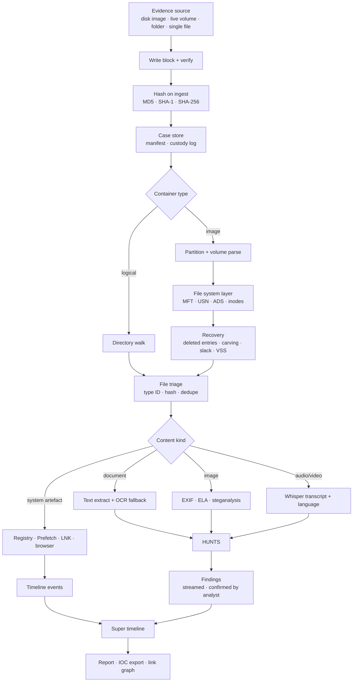

# Digital Forensics Workshop — build plan

Scoped 2026-09-10. Own repository, consumed by ATK as an **optional
submodule**, on the CyberWolf pattern.

## Status — Phases 1 and 2 built 2026-09-11

**Phase 1** — all six items of §8: the case store and custody log, hashing,
read-only enforcement and its AST ratchet, logical folder ingest with
signature type ID and dedupe, browser SQLite artefacts, and the ATK host page
through the airlock.

**Phase 2** — the file system layer (§5), the same day: RAW/DD and split
images; MBR (with the extended chain) and GPT, CRCs and the backup checked;
NTFS `$MFT` with fixups checked, attribute lists, sparse and fragmented runs
and ADS; deleted entries with their clusters measured against `$Bitmap` and
paths checked against parent sequence numbers; timestomp indicators
(`$STANDARD_INFORMATION` vs `$FILE_NAME`) as measurements with their benign
explanations; `$UsnJrnl:$J` (V2/V3/V4); file slack; signature carving of an
image, a volume, a gap or a volume's unallocated clusters, every result a
candidate with the basis of its length; preview that writes nothing and
recovery that records how the bytes were found. ATK gained **Disk Image** and
**Carving** pages. Engine 0.2.0; `python -m unittest discover -s tests`
(249 tests on a machine with ntfs-3g, sfdisk and sgdisk; the six real-tool
tests skip elsewhere).

**Phase 3 — begun (2026-09-12): DOMEX over a disk image** (`forensics_workshop/
domex.py`, §10.7's "parsed rows before you can hunt them"). Over an NTFS volume
it types every eligible file and mines the high-value categories into the
`artefacts` index: **documents** (OOXML docx/xlsx/pptx and OpenDocument
properties, a PDF `/Info` scan — author, title, created/modified UTC, producing
app), **images** (JPEG/TIFF EXIF including the **full GPS IFD** — signed
lat/lon, altitude, the UTC GPS timestamp — the input to the geospatial view),
and **email** (EML and mbox headers, one row per message, Date → UTC). Reads
through the read-only door; writes nothing to disk; the file-system time is the
row's measured `at_utc`, a document's or camera's own times are authored and
kept in `detail` with their epoch named. CLI `domex` / `domex-list`
(`--geo` filters to geotagged rows). 16 tests (`tests/test_domex.py`), 296 on
the device. `mobile-analysis` was the first Phase-3 item; DOMEX is the second.

**Phase 3 — the runbook + the review queue (2026-09-12).** `pipeline.py` is the
deterministic end-to-end runbook (`auto`): on a registered disk image it runs
hash → partitions → NTFS → DOMEX → slack (carve optional) on every NTFS volume,
resumable (skips steps already in the index), unattended (one failing step is
recorded and the run continues; it asks nothing mid-run), no model. `review.py`
is the man-in-the-middle of §6/§10: engine and (later) local-model **proposals**
land in `findings.jsonl`; an examiner's confirm/reject lands in
`decisions.jsonl` and the custody log; only a confirmed finding is admitted
(`confirmed()` — the view the report and graph will read). So an overnight
`auto` run does all the deterministic work and parks its proposals for morning
review — unattended ease of use without a finding no human stood behind. CLI
`auto` / `findings` / `confirm` / `reject`. This is the frame the §10 hunts and
contact graph plug into next.

**Planned 2026-09-30 — media recovery (§12), nothing built yet.** Bill's new
direction: pull a faint voice out of a radio transmission, recover what a
background speaker says in a phone recording before the clip cuts off (including
when the picture goes dark), and bring out detail in photos and video, shadows
included, without inventing it. Not for court — *"that recovery can save a
life."* §12 is the spec: five trust tiers on every output, replayable recipes,
a faithful lane that feeds decisions and a labelled generative lane that only
proposes, **Meta's SAM Audio run through audio.cpp as an owner-approved licence
exception**, and a validation harness built before any model is trusted. The
tool survey behind it is `research/media_recovery_tools_2026-09-30.md`.

**Media — SAM Audio built 2026-10-05, not yet run on Windows.** Bill: *"Let's
go ahead and build in SAM for forensics as well."* Built: the
`forensics_workshop/media/` subpackage — the five tiers and replayable recipes
(§12.2–12.3) with a sidecar beside every output; the generic prompted-separator
interface; the SAM adapter over **audio.cpp v0.9.0**'s `audiocpp_cli`, always a
subprocess, with flags checked against that tag's own docs (§12.9); input from
any audio or video file (FFmpeg extraction as a measured step, the original
read once through the read-only door); several seeds and **where they
disagree**; `.invented` in every SAM filename; outputs only in the case with
`media.started/derived/failed` custody; pinned-hash weights (unpinned = "weights:
unverified (parity not run)", a different file = refused); the negative-control
hook (§12.12); SAM as a named **owner exception** in `capabilities`; CLI
`media-sam/-list/-replay/-pin/-weights/-negative-control`. In ATK: the **Media
Lab** page (tenth, after Findings), run inside the AI queue, players on the
audio-focus bus; `get_sam.bat` builds the runtime and fetches the weights. 90
new engine tests, all through a FAKE `audiocpp_cli` — **no real SAM run, no
parity check, no negative control on real noise, and no VRAM or speed figure on
the 3080 Ti yet.** Hardened the same day after an independent review (odd
WAVs through FFmpeg, invented inputs tracked by name and hash, pins matched by
hash, tool-floored tiers, child-process writes guarded, broken stems refused,
crash codes in words). Details and the unproven list: §12.9 and §12.14.

**Media — 2026-10-09: SAM must run on the GPU.** The first Windows test ran SAM
on a CPU build that `get_sam.bat` had fallen back to after its CUDA build
failed — hours of work with no GPU and nothing on screen. Now: a CPU build is
refused (engine and ATK; `--allow-cpu` to override), `get_sam.bat` makes none
unless asked (`/cpu`), keeps every build's full output in
`logs\get_sam-build.log`, pins the CUDA build to Visual Studio 2022; the
child's TEMP is beside the runtime, never the Windows profile; a heartbeat
names the backend and audio.cpp's last line every 10 s; every log ends saying
how the child ended; every run is logged in ATK's `atk.log`.

**Built 2026-10-09 — Restore Audio and Voice Print (§13).** Bill's three asks:
automated analysis of what will restore a recording, chains of methods when the
analysis says they help, and voice prints *"with a percentage probability"* — as
a lead, not courtroom evidence. **Restore Audio** measures a recording (noise,
hum, rumble, DC, clipping, clicks, bandwidth, level), ranks restoration chains
least-invasive first (FFmpeg filters; SpeechBrain MetricGAN+ and SepFormer;
two-voice separation offered, never the default), runs the best, the ticked or
all of them, aligns every output to the original, keeps its residual and
measures what each took and added — and looks for **faint sounds** (§13.8):
channels that carry one sound combined (maximal-ratio, Recovered), a salience map of what
stands out of the recording's own noise over windows up to 16 s with a clip of
each faint event, tonal lines, and repeats averaged (10·log10 N dB) or lifted
off. The same day, later: **DeepFilterNet 3 and RNNoise** beside SpeechBrain's
models, every speech model marked **SPEECH ONLY**; **what the file really
holds** (a codec's or telephone's cut, a lower rate, no anti-alias roll-off,
energy below 20 Hz) and a linear map above 12 kHz; and **shift into hearing**
— a band above or below hearing moved into it, with a slowed or sped-up copy
(§13.9). **Voice Print**: SpeechBrain's ECAPA speaker
model (Apache-2.0) in its own process, case-scoped profiles, a percentage only
when calibrated, Invented audio refused, every comparison a review-queue lead.
`get_speechbrain.bat` installs it all. Tested here through fakes over the real
subprocess path, the models through SpeechBrain 1.1.1 on stand-in weights, and
the two ATK pages under real Qt; **not yet run on Windows or on the real
weights** (§13.7).

**2026-10-29 — SAM Audio REMOVED (Bill: "Go ahead and remove Sam").** Gone:
`media/sam_audio.py`, the prompted-separator interface (`separator.py`), the
weights manifest (`weights.py`), seed disagreement (`disagreement.py`), SAM's
part of `lab.py` (run, windows, replay, negative control), the `media-sam /
-list / -replay / -pin / -weights / -negative-control` commands, the SAM and
audio.cpp capability rows and the owner exception (`OWNER_EXCEPTIONS` is now
empty; the mechanism stays). The child-process runner that restoration and
voice comparison were already using moved to `media/proc.py`; `lab.py` keeps
only what they share. In ATK: the Media Lab page, `get_sam.bat`, the
install.bat step and summary line, and the component entry. A case made before
then may still hold SAM runs under `<case>/media/`: they are not deleted and
still read back as Invented. §12.9 below is kept as the record of what was
built.

**2026-10-29 — drive imaging BUILT (`acquire.py`, `ewfwrite.py`).** Bill:
*"Lets build in everything starting with the hunts and a hard drive imager."*
A physical drive or one volume to EnCase E01 (fast / best / no compression) or
RAW, one file or split; MD5/SHA-1/SHA-256 in the read; unreadable sectors
retried, zero-filled and listed (log, custody, E01 `error2`); read back and
hashed again; FTK-style log; custody and registration in the case. Two new
writer kinds in the ratchet — `acquisition` (only into the examiner's
destination, never a case, never the source's disk) and `device-query` (only
read-only control codes). The E01 writer is held to libewf's `ewfverify` and
`pyewf` as well as `ewf.py`: single and split sets, every compression,
`error2`, and base-offset tables past 2 GiB all pass. CLI `drives`, `acquire`.
ATK: the **Acquire** page (second, after Case). **Not yet run on a real
Windows drive** — the Windows drive queries are written to the documented
structures and guarded, and the first real run is the test.

**2026-10-29 — Hunts: the model layer BUILT (§10.2's second layer).** In ATK,
`atk/core/dfw_ai.py`, over the engine's new `corpus.py` (lists a case's
pictures, videos, documents, text and e-mail; reads one into memory through
the read-only door; one hashed working copy of a video for FFmpeg, with
custody). Four layers, every result a PROPOSAL attributed `model:<file>`:
Image Analysis's hunt library over every picture; **30 frames per video, one
at a random moment in each of 30 equal stretches**, seeded from the video's
hash so a re-run samples the same frames, decoded through a pipe and never
written; text hunts whose finding is a **verbatim quote, checked against the
text**; and **translation with its reasoning** (source language, confidence,
each idiom / slang / code word / ambiguity with how it was rendered and why,
what could not be translated), the original kept verbatim beside it. ATK: the
**Hunts** page (deterministic hunts and the model's, with an estimate) before
Findings; Findings colours leads by who made them (engine cyan, model violet)
and shows them readably. Engine 0.3.0.

**FTK parity — §14** is the honest comparison and the build order Bill asked
for ("build in everything").

`python -m forensics_workshop capabilities` lists what is built, what is not,
and which routes the licence rule excludes.

**Four decisions from Bill that change this plan as written:**

- **The package is `forensics_workshop`, not `forensics`** (§7). ATK already
  has `atk/core/forensics.py`, and the airlock decides "installed" by
  importing a name — a generic one can be answered by the wrong thing.
- **The licence is the same as ATK's: all rights reserved.** It is not
  Apache-2.0 like CyberWolf and the Writing Workshop. See `LICENSE`.
- **In ATK the workspace sits immediately after Image Analysis**, ninth in
  the rail.
- **Nothing that restricts commercial use** (§1.1, 2026-09-11, corrected the
  same day). Any third-party code — and everything it pulls in or bundles —
  must permit commercial use of this closed product: permissive, or weak /
  file-level copyleft (LGPL, MPL, EPL, and the IPL/CPL over the Sleuth Kit
  core). Whole-program copyleft (GPL, AGPL, the Volatility Software License)
  and non-commercial licences are excluded. So the libyal libraries and pytsk3
  all pass; the engineering default is still native for the offline property,
  so E01, virtual disks, shadow copies and ESE are planned native with the
  library named as the alternative, APFS is the one library route, and memory
  analysis is deferred (Volatility 3 and MemProcFS fail the rule).

**Built beyond the letter of the plan, because the spine needed it:** a
hash-chained custody log with an anchor kept outside the case (ATK's case
index), so a rewritten log is caught; WAL-aware browser parsing; before-and-
after timestamps on every read, so a last-access change is *measured*; cloud
placeholders recorded and not read; a command line, which is the engine's own
surface and the seed of its reachability guard; and — in Phase 2 — refusal of
container formats read as raw, naming of GPT entries altered in one copy of
the array, a digest of every run's rows in custody, and a cross-check of the
parsers against real ntfs-3g and util-linux output.

**Not yet proven:**

- **The ATK pages have not been built under real Qt.** No package index was
  reachable that day; the pages were driven through a stand-in for PySide6
  (87 checks, every handler of all eight pages), which proves the Python and
  not the Qt calls. Run `tests\test_dfw_pages_build.py` in ATK — it now also
  asks real Qt to draw a carved PNG thumbnail.
- **No volume written by Windows has been parsed.** The real-tool tests use
  NTFS written by ntfs-3g, which is real NTFS but not Windows' own; the first
  Windows image is the next test. **DOMEX inherits this**: it is proven end to
  end on a synthetic NTFS volume and its document extractors are proven on real
  files (the ATK folder's genuine docx/pptx/PDFs from several producers), but it
  has **not yet run over the real Party Girl Windows volume** — that needs the
  E01 registered as a disk image and NTFS-parsed first, and the image was not in
  a connected folder at build time.
- **The EXIF/GPS path is proven on a spec-correct synthetic JPEG, not yet on a
  real camera file** — none with EXIF were reachable. The synthetic builder
  follows the TIFF inline-value rule the reader depends on, so it exercises the
  reader rather than sidestepping it, but a real geotagged photo is the next
  test.
- **The change journal has only met synthetic records** laid out from the
  documented structures; ntfs-3g does not keep one.
- **Not built in Phase 2:** LZNT1 decompression (compressed streams are
  refused, not returned), FAT/exFAT directories (volumes are identified and
  can be carved), ext4, VHDX/VMDK (to be native, §1.1; **E01/EWF is now BUILT**), Volume Shadow Copies (Phase 4),
  `$MFT`/`$J` files exported by collection tools such as KAPE. (A live
  physical-device reader — the drive imager — was built 2026-10-29.)
- The USB `WriteProtect` policy and the write probe have not run on Windows.

---

## 0. The two decisions that shape everything else

### 0.1 It is a separate repo, and it goes through the airlock

ATK already has the pattern and has already been burned by getting it wrong:
CyberWolf reported *"not installed"* when it was installed, three times, because
a page constructor raised and the failure was rendered as a missing repo. The
rule that came out of it is absolute and this repo inherits it:

> **Past the line where the vendor package imported, no failure may be
> reported as a missing repo.**

So the ATK side is a thin host that (a) imports, (b) reports the *actual*
`Reported:` line on failure, and (c) calls `subsystem.forget()` on teardown. The
`_unavailable_page` says which of the three states it is in — not installed,
installed but failed to load, installed and loaded but a capability is missing —
because those need three different actions from the operator.

Consequence for this repo: **it must be usable and testable standing alone**,
with no ATK import anywhere in its core. ATK supplies the model, the panel and
the hunts; the forensics engine supplies evidence handling and knows nothing
about Qt.

### 0.2 Evidence does not live in the ATK folder

ATK's standing rule is that every result lives inside the ATK folder. **This
module is the deliberate exception**, and the reason should be written down
before someone "fixes" it: a case is the operator's, often on a different
volume, frequently larger than the application, and sometimes required to sit on
media that is handled under its own rules. A case folder is chosen per case and
remembered by path.

What ATK *does* keep is the **case index** — where cases are, when they were
opened, their hashes — so a case can be found again without the toolkit holding
the evidence.

---

## 1. The honest capability table

Bill's requirement is offline-first with no external APIs. That is achievable
for most of this list and **not** achievable for all of it without vendoring
third-party code, some of which carries licence terms ATK has already had to
refuse once (`pykakasi`, GPL-3.0, refused with `--no-deps`).

So before any build order, the honest breakdown. **Native** means ATK writes it
in Python against a documented format — the house style, and already proven
against the Midas BLUE layouts and the stdlib OSM PBF reader.

| capability | how | honesty note |
|---|---|---|
| Hashing MD5/SHA-1/SHA-256 | **native** (`hashlib`) | trivial, and the foundation |
| RAW/DD image reading | **native** | it is a byte stream |
| E01 / EWF reading | **native** (`zlib`) — BUILT (`ewf.py`, 2026-09-12) | sections + volume/disk geometry + base-offset table + zlib chunks → one raw stream; verified on a real 20 GB EnCase image (BelkaCTF Party Girl). pyewf (libewf, LGPL) is the licence-permitted alternative. Ex01 still refused |
| AFF4 | **native**, low priority | rare in practice. pyaff4 is Apache-2.0 (permitted), but the engine avoids dependencies by default |
| VHD/VHDX/VMDK | **native** by default | a fixed VHD is read already; the rest follow published specifications. pyvhdi/pyvmdk (libyal, LGPL) are licence-permitted alternatives — the "Apache-2.0-ish" this row once said was wrong |
| Partition tables (MBR/GPT) | **native** | documented, small |
| NTFS: `$MFT`, `$USNJrnl`, ADS | **native** | the formats are published and stable; this is exactly the kind of parser this project writes well |
| FAT/exFAT | **native** | small |
| Ext4 inodes, orphan recovery | **native**, non-trivial | superblock + inode tables are documented; extent trees are the work |
| APFS | **pyfsapfs** (LGPL, permitted) when built; deferred for now | genuinely hard; the one place a permitted library is the plan rather than a native parser |
| Full TSK coverage | **native**, one filesystem at a time | pytsk3 (Apache-2.0 over an IPL/CPL core) is licence-permitted as a breadth fallback |
| File carving by signature | **native** | a signature table plus a scanner; ATK should own this |
| Volume Shadow Copies | **native** | offline, from an image. pyvshadow (LGPL) is a licence-permitted alternative |
| Registry hives | **native** | the hive format is well documented. `python-registry` is Apache-2.0 from 0.2.0 (GPL-3.0 before), but the engine takes no dependencies |
| Prefetch | **native** | Win10+ MAM compression needs `RtlDecompressBufferEx` — available on Windows through `ctypes`, no third party |
| LNK / Jump Lists | **native** | Shell Link + OLE compound file; documented |
| Amcache / Shimcache | **native** (they are registry/hive) | |
| Browser artefacts | **native** (`sqlite3` stdlib) | Chrome/Firefox/Edge are SQLite; this is the cheapest high-value win in the whole list |
| ESE databases (SRUM, Windows Search) | **native** | documented, and a real piece of work. pyesedb (LGPL) is a licence-permitted alternative |
| EXIF / document metadata | **native** (PIL + existing `forensics.py`) | already partly built |
| Steganalysis (LSB, chi-square, RS) | **native** | `forensics.py` already does ELA and noise fingerprinting; this is an extension of work that exists |
| OCR | **existing `ocr.py`** | already in ATK |
| Audio transcription | **existing Whisper path**; consensus across ASR families planned (§12.6) | already in ATK. Whisper writes text on silence and noise, so a word counts only when two model families agree |
| Audio recovery (faint radio voice, background speech) | **native DSP** (atkdsp kernels) + permitted models in separate processes — PLANNED §12 | the faithful lane recovers or fails visibly; generative separators (SAM Audio) are labelled leads |
| Photo / video detail and shadow recovery | **native** multi-frame + permitted regressive models — PLANNED §12.8 | real detail comes from more frames and richer sources (RAW, gain maps), not bigger priors |
| Damaged / truncated media repair | **native** (ISOBMFF, H.264/HEVC NAL, ADTS/Ogg/AMR/MP3 framing) + untrunc arm's-length — PLANNED §12.7 | the tail of an interrupted recording is usually still in `mdat`; only the index is missing |
| Memory (RAM) analysis | **deferred** | **no licence-permitted route**: Volatility 3 (its own copyleft licence) and MemProcFS (AGPL-3.0) both reach our source. Native, if it earns its place after Phase 4 — with its own symbol-table problem |
| Super timeline | **native** merge | the merge is easy; the parsers above are the work |
| Encrypted volume *detection* | **native** | signatures for BitLocker/LUKS/FileVault are identifiable |
| Encrypted volume *decryption* | **out of scope for v1** | key extraction from hibernation/memory is a real capability and a real rabbit hole; do not promise it in the same breath as detection |

**What this table is for**: so that a phase does not get planned around a
capability that turns out to need a package we cannot ship. Every "native" row
is a week of work and no licence risk. A third-party row is admissible only if
it passes §1.1 — and none of the ones this table first named does.

### 1.1 The licence rule — nothing that restricts commercial use

**Bill, 2026-09-11: nothing that will restrict commercial use.** Said at the
start, so nothing is built on a library that has to be torn out later.
Corrected the same day: an earlier draft of this section read the rule as
"permissive only" and put LGPL on the excluded side. **That was wrong — LGPL
does not restrict commercial use.** As the rule actually applies:

- **Two tiers pass**, for anything the engine would import, bundle or require,
  its dependencies included:
  - *permissive* (MIT, BSD, Apache-2.0, ISC, PSF, zlib, CC0 …) — keep the
    notice; no effect on our own code;
  - *weak / file-level copyleft* (LGPL-2.1/3.0, MPL-2.0, EPL, and the IPL/CPL
    that cover the Sleuth Kit core) — commercial use of a closed product is
    fine. The cost is shipping the library's licence text, publishing any
    change you make **to that library** (never your own code), and leaving it
    replaceable — automatic in Python, where imports are dynamic and the user
    can swap in their own build.

  The allowlist is `PERMISSIVE_LICENCES | RECIPROCAL_LICENCES` in
  `capabilities.py`; a licence nobody has checked is refused, not waved through.
- **Excluded: whole-program copyleft and non-commercial.** GPL, AGPL, and the
  Volatility Software License — which requires publishing the source of
  software built *with* it — would force this engine open. PolyForm-NC,
  CC BY-NC, BUSL and SSPL restrict commercial use outright.
- **The whole tree counts.** A permissive package that bundles a copyleft one
  carries it. pytsk3 is the case, and it passes only because the Sleuth Kit's
  IPL/CPL are themselves weak copyleft.
- **Passing the rule is not the same as being used.** The engineering default
  is native and standard-library-only: the engine runs in a bare interpreter,
  installs nothing and bundles no licence texts. A permitted library is reached
  for only where a native parser would be a poor use of time.
- **Formats are implemented from their documentation**, never by copying or
  translating code from a GPL/AGPL project whose terms would reach this code.
- **An examiner's own tools are not dependencies.** Converting an E01 to raw
  with FTK Imager or ewfexport before registering it is the examiner's step;
  nothing of those tools ships with the workshop or is needed by it.

Where each library the plan first named now stands:

| library | licence | rule | plan |
|---|---|---|---|
| pyewf (libewf) | LGPL-3.0-or-later | **permitted** | E01 read natively (BUILT, `ewf.py`); library is the alternative |
| pyvhdi, pyvmdk (libyal) | LGPL-3.0-or-later | **permitted** | VHDX/VMDK/dynamic VHD native by default |
| pytsk3 (Sleuth Kit) | Apache-2.0 AND IPL-1.0 AND CPL-1.0 | **permitted** | filesystems native, one at a time; library a breadth fallback |
| pyvshadow (libvshadow) | LGPL-3.0-or-later | **permitted** | Volume Shadow Copies native (Phase 4) |
| pyesedb (libesedb) | LGPL-3.0-or-later | **permitted** | ESE native (Phase 4) |
| pyfsapfs (libfsapfs) | LGPL-3.0-or-later | **permitted** | APFS — the one place the library IS the plan, when built |
| Volatility 3 | Volatility Software License 1.0 | **excluded** | memory deferred |
| MemProcFS; Fox-IT dissect.evidence | AGPL-3.0 | **excluded** | not used, and not a source to copy from |

**Media recovery (§12) brings its own licence table (§12.10) and two
changes to how the rule is applied.** CC-BY-4.0 (attribution only; several
speech-recognition and diarization models) joins the permissive tier — it does
not restrict commercial use. And the rule gains its first **owner exception**:
SAM Audio's weights carry Meta's SAM License, which permits commercial use but
bans military/warfare, espionage and ITAR-controlled end uses. Bill accepted it
on 2026-09-30 — *"if it goes to defense related work, we'll replace or remove
it then."* An exception is never a silent allowlist entry: it is recorded with
its reason and its removal trigger, shows as such in `capabilities`, and sits
behind one adapter so removing it removes nothing else.

Only the two excluded rows appear as **excluded** in the capability table,
each with the licence that fails; `tests/test_capabilities_packaging.py` holds
every third-party row to the allowlist and shows a failing row as excluded even
if someone adds it as planned.

**One thing the rule does not decide: FDE decryption.** Detecting an encrypted
volume is native and available. Decrypting one, given the key, needs a
symmetric cipher (AES-XTS) and a KDF the standard library does not provide. The
permissive crypto libraries — `cryptography` (Apache-2.0/BSD) and
`pycryptodome` (BSD/public-domain) — pass the rule, so this is not a licence
question; it is the separate decision of whether to take the engine's first
dependency and give up the bare-interpreter property.

**Beyond this repository.** Phase 3 leans on ATK's own components — OCR,
Whisper, Pillow — and ATK has dependencies under the same question: PySide6,
which draws every ATK page, is LGPL-3.0 (permitted, with the same
notice/replaceability cost); the bundled FFmpeg builds are GPL-3.0 (a binary
shipped, not a library linked — a real question). That review belongs to ATK.

---

## 2. The pipeline



Two things to notice about the shape.

**Everything converges on hunts.** A document, a photograph, a voice memo and a
registry key are four extractors feeding one question-answering layer. That is
why the hunt engine is being built shared (see ATK `FUTURE_PLANS.md` §H) — this
module is its third front door, and if it were built separately here there would
be three answers to "what is a finding".

**Preview before recovery.** Bill: *"With previews where possible before
recovery."* Every recovery path — a carved file, a deleted MFT entry, a shadow
copy — yields a **header, a size, a type guess and a thumbnail or first page**
before anything is written out. Carving a 40 GB unallocated region produces
thousands of candidates and most are fragments; recovering them all first and
looking after is how an analyst loses an afternoon.

---

## 3. Write blocking, and the part that must not be oversold

This is the capability where a toolkit can do real harm by being confident.

**A software write blocker on Windows is not a hardware write blocker.** What
can honestly be built:

1. **Read-only by construction.** Every handle this module opens on evidence is
   opened read-only, on every path, with no exceptions and an **AST ratchet
   asserting no `"w"`, `"a"`, `"r+"` or `os.O_WRONLY` reaches an evidence
   path.** This is the guarantee that is actually enforceable, and it is
   enforceable because it is structural rather than a promise.
2. **USB write protection via the documented registry policy**
   (`HKLM\SYSTEM\CurrentControlSet\Control\StorageDevicePolicies\WriteProtect`).
   Requires elevation; affects USB mass storage only; **does not cover
   Thunderbolt, internal buses, or anything already mounted.**
3. **Verification, which is the part that matters.** Set the policy, then
   *attempt a write and confirm it fails*, and report the result of the
   attempt. A setting that was applied is not the same claim as a device that
   refused a write. This module reports the second.
4. **Mount-state warnings.** If Windows has already mounted and journalled a
   volume, saying so plainly, because by then the evidence has already changed
   and no tool can undo it.

**What the UI must say, prominently and permanently**: for evidence that will be
presented anywhere it matters, use a hardware write blocker. This module's
protection is defence in depth, not a substitute. A forensics tool that implies
otherwise is worse than one with no write blocking at all, because it removes
the operator's reason to reach for the real thing.

---

## 4. Chain of custody

The case store is the spine, and the design rule is the one CyberWolf's actor
ledger arrived at: **the record is append-only and it never states a conclusion.**

```
<case>/
    case.json          identifier, examiner, opened, description
    custody.jsonl      append-only: every action, actor, timestamp, hashes
    evidence/          source images and their sidecars (read-only)
    extracted/         everything recovered, by source
    findings/          hunt findings + analyst decisions (the §H store)
    reports/
```

- **Hash on ingest, hash on export, and verify on demand.** The verify is a
  first-class button, not a setting — an examiner is asked *when* a hash was
  last confirmed, not whether hashing is enabled.
- **`custody.jsonl` is append-only and separately flushed and `fsync`ed.** Same
  reasoning as the GPS track: a log that only survives a clean shutdown does not
  survive the situations it exists for.
- **A recovered file records how it was recovered** — MFT entry, carved at
  offset, shadow copy N, slack space — because "recovered" spans claims of very
  different strength and a report that flattens them is misleading.
- **Nothing here says a file is a file.** A carved JPEG whose header parsed and
  whose tail is missing is a *candidate*, and it is labelled one all the way to
  the report.

---

## 5. Phases

### Phase 1 — the spine (build this before anything clever)

Ingestion, hashing, case store, custody log, read-only enforcement + its AST
ratchet, logical folder walk, file type identification by signature, dedupe by
hash, and the ATK host page through the airlock. **Plus browser SQLite
artefacts**, because they are stdlib, high value, and prove the whole spine
end to end on real data with no third-party dependency at all.

Deliverable: point it at a folder or a mounted volume, get a hashed, indexed,
custody-logged case with browser history in it.

### Phase 2 — the file system layer

RAW/DD and partition parsing, NTFS `$MFT` and `$USNJrnl`, ADS enumeration,
deleted-entry recovery, **signature carving with preview**, slack and
unallocated scraping, timestomp detection (`$FILE_NAME` vs
`$STANDARD_INFORMATION`). E01 and the virtual disk containers (VHDX, VMDK,
dynamic VHD) **natively by default** — the libraries that read them are
licence-permitted (§1.1) but native is the choice — and not built yet.

### Phase 3 — DOMEX and hunts

Text extraction + OCR fallback, EXIF and Office/PDF metadata, steganalysis
extending the existing `forensics.py`, Whisper on every audio and video file,
and the **hunt engine wired across all of them**. This is the phase Bill
described first and it is third on purpose: hunts over an unverified,
un-custodied corpus produce findings nobody can stand behind.

**Mobile image analysis** (Bill, 2026-09-11) also lands here: comprehensive
native analysis of an already-extracted image — **not acquisition**, which
needs physical-device protocols and stays out of scope. It is large enough to
have its own spec: **see §9**. Increments 1-2 (the iOS backup file map + the
messages/calls/contacts/Safari parsers) are built; §9 is the full plan and the
remaining increment order.

**Audio, per his note**: Whisper first, transcript into the hunt corpus, and
**the language tagged by task, not by detected language** — the subtitles path
already learned that one. A non-English source is noted on the finding, and the
transcript keeps both the original and the translation rather than replacing
one with the other.

### Phase 4 — system state and timeline

Registry hives, Prefetch, Amcache, Shimcache, LNK and Jump Lists, ESE
databases and Volume Shadow Copies (both native, §1.1), and the **super timeline** merging file system
timestamps, event logs, browser history and artefact events into one ordered
record. IOC export to CSV/JSON, and STIX **only if a consumer for it actually
exists** — an export format nobody reads is a week spent on nothing.

### Phase 5 — memory, and only if it earns its place

**Deferred: no route passes the licence rule** (§1.1). Volatility 3 and
MemProcFS are both copyleft, so process and thread extraction, injection
detection and network state reconstruction would be written natively — a large
body of work with its own symbol-table problem, and a different skill set.
Worth doing; not worth doing before phases 1–4 are solid.

**Explicitly out of scope for v1**: FDE key extraction and volume decryption,
APFS, and mobile device acquisition. Detection of all three, yes. Handling,
later, deliberately.

---

## 6. Where the LLM belongs — and where it does not

Bill: *"Consider comprehensively how visual analysis and document analysis using
LLMs can be leveraged."*

Comprehensively, and the boundary matters more than the list.

**Good uses — judgement over extracted facts:**

- **Hunts** across documents, images and transcripts. The core of it.
- **Triage ranking**: given 40,000 recovered files, which 200 should a human
  open first, and why — with the reason in the model's own sentences, which is
  already the rule the vision path enforces (`why` is the whole point; a bare
  label cannot be argued with).
- **Cross-artefact correlation proposals**: this LNK file, this browser
  download and this USB serial appear to describe one event. **Proposed**, then
  confirmed by the analyst, onto the link graph — the same man-in-the-middle
  design as the image hunts.
- **Timeline narration**: turning a 400,000-row super timeline into "here is
  what appears to have happened between 14:02 and 14:19", with every sentence
  citing the rows it came from.
- **Explaining an artefact** to an examiner who has not met it before. This is
  the Signals Analysis Assistant pattern, pointed at forensics.

**Where it must never go:**

- **It does not decide what a file is.** Type identification is signatures and
  magic numbers. A model's guess in that field would flow into the report as
  fact.
- **It does not touch hashes, timestamps or offsets.** Measured values, and the
  measured/authored boundary this project already enforces in the writing
  engine applies here with more force.
- **It does not write to `custody.jsonl`.** Ever.
- **Its output is always attributed and always dated with the model that
  produced it**, exactly as the online core stamps every remote answer.
- **A finding it produced is a finding, never a conclusion**, and the report
  says which of its sentences came from a model.

---

## 7. Repository shape

```
Digital-Forensics-Workshop/
    pyproject.toml
    README.md
    FORENSICS_PLAN.md          this file
    forensics_workshop/        (built as forensics_workshop — see Status)
        __init__.py            __version__, capability probe
        case.py                case store, custody log, manifest
        hashing.py
        blocker.py             read-only enforcement + USB policy + verify
        containers/            raw, ewf, vhd, partitions
        filesystems/           ntfs, fat, ext4
        recovery/              carve, slack, unallocated, vss
        artefacts/             registry, prefetch, lnk, browser, ese
        domex/                 metadata, stego, ocr bridge, transcript bridge
        timeline/              events, merge, export
        report/                markdown, docx, IOC export
        media/                 recovery recipes, trust tiers, residuals, model adapters (§12)
    tests/                     runs standalone, no ATK, no Qt
    samples/                   synthetic images built by script, never real evidence
```

- **`samples/` are generated, never committed.** A build script writes a small
  NTFS image with known deleted files and known ADS. Committing real evidence to
  a repository is a mistake nobody undoes, and synthetic samples make the tests
  deterministic besides.
- **Tests import no ATK and construct no `QApplication`.** The suite must go
  green in a bare checkout, or the airlock cannot be tested at all.
- Public entry points enumerated and covered by a **reachability guard** — the
  same set-equality ratchet ATK uses, because a re-export is an offer, not a
  path, and this repo will accumulate engines faster than surfaces.

---

## 8. First session's work

1. `pyproject.toml`, package skeleton, version, capability probe.
2. `case.py` + `hashing.py` + `custody.jsonl` with `fsync`, and their tests.
3. `blocker.py` read-only enforcement and the AST ratchet — the guarantee that
   is actually enforceable, built before anything that could violate it.
4. Logical folder ingestion end to end: point it at a directory, get a hashed
   case with a custody log.
5. Browser SQLite artefacts, as the first real extractor.
6. The ATK host page through the airlock, reporting all three unavailable
   states correctly.

That is a standing, testable, honest tool with no third-party dependency and no
licence question — and every later phase plugs into it rather than reshaping it.

---

## 9. Mobile analysis — the comprehensive build plan

Analysis of an already-extracted mobile image. **Never acquisition** (physical-
device protocols and exploits — out of scope). Bill, 2026-09-11: "as
comprehensive and capable as possible," built native, in tested increments.

**The dimension the first cut missed: the EXTRACTION TYPE.** The same phone
yields very different data by how it was extracted, and the highest-value
artefacts are not in a backup at all. The engine identifies what it was handed
and routes accordingly.

### 9.1 Scope (Bill's decisions, 2026-09-11)

- **Input types: backups + full-filesystem file trees.** iOS iTunes/Finder
  backups (encrypted and not) and full-filesystem extractions delivered as a
  file tree (tar/zip of real paths); Android ADB backups and file-tree dumps.
  **Not** raw physical images (APFS/ext4/f2fs partitions) yet — those ride on
  the Phase-2 filesystem work and are a later addition.
- **Encrypted backups: detect now, decrypt with a PERMITTED crypto dependency.**
  `pycryptodome` (BSD/public-domain) or `cryptography` (Apache/BSD) — both pass
  the §1.1 licence rule. Design: an **optional** dependency, imported lazily
  only in the decryption path, declared as a `pyproject` extra. The engine still
  imports and runs standard-library-only in a bare interpreter; decryption
  reports "available" only when the library is present, degrading honestly when
  it is not. This is the engine's first third-party dependency, and it is
  optional by construction so the offline/bare-interpreter property survives
  everywhere except the one feature that needs a cipher. `test_isolation` gains
  a single named exception for the guarded optional import.
- **Third-party apps: a pluggable registry + a starter set.** Register a parser
  by path + schema signature; starter set WhatsApp, Signal, Telegram, Snapchat,
  Instagram, Facebook Messenger, Google Maps. Others are added as plugins
  without touching the core.

### 9.2 Cross-cutting plumbing (correctness depends on it)

- **NSKeyedArchiver / `attributedBody`.** On iOS 12+ a message's `text` column is
  often NULL and the real text is in `attributedBody` as an NSKeyedArchiver
  `NSAttributedString`. **The increment-2 SMS parser misses this — a correctness
  gap to close first.** A native NSKeyedArchiver decoder also unlocks the
  Manifest `file` blob, many plists, and Notes bodies.
- **SQLite deleted-record recovery** (free pages, WAL frames, journals) — "the
  deleted texts." A distinct, reusable capability that also serves the browser
  and disk parsers.
- **Protobuf** — Android `usagestats`, iOS Biome/SEGB, Google/app payloads. A
  small native reader; no dependency.
- **The epoch zoo + timezone** — Cocoa (s/ns), Unix (s/ms/µs), WebKit, FILETIME
  are handled; add **Google µs-since-1970**. Every timestamp keeps raw + decoded
  + epoch (house rule).
- **Encryption detection everywhere**, decryption where a key/password is given:
  encrypted iOS backups (keybag → per-file AES), Android FBE (detect; decrypt
  only with keys), WhatsApp `crypt15`, encrypted app DBs.

### 9.3 iOS artefact catalogue   (B = in a backup, F = full-filesystem only)

- **Comms:** Messages incl. attachments, group chats, reactions, edited/unsent
  (iOS 16+) (B); Call history + FaceTime (B); Voicemail + audio (B); Mail (F).
- **PIM:** Contacts (B, built), Calendar, Reminders, Notes (`NoteStore` /
  `notes.sqlite`, gzip'd protobuf bodies) (B).
- **Web:** Safari history (B, built) + bookmarks (`Bookmarks.db`), tabs
  (`BrowserState.db`), downloads; other browsers (F).
- **Location & pattern-of-life (mostly F):** `knowledgeC.db` (app usage, device
  lock/unlock, now-playing, notifications — the crown jewel), `CurrentPowerLog.
  PLSQL`, location caches (`Cache.sqlite`, `cache_encryptedB.db`), `routined`,
  `interactionC.db`.
- **Media:** `Photos.sqlite` (Camera Roll: GPS, faces, albums) + EXIF/GPS on files.
- **Device/network:** `preferences.plist`, `CellularUsage.db`, `DataUsage.sqlite`
  / `netusage.sqlite`, Wi-Fi (`com.apple.wifi.known-networks.plist`), Bluetooth
  (`…ledevices.paired.db`), `applicationState.db`, `TCC.db` (permissions),
  Screen Time, HomeKit.
- **Health** (encrypted backup / F): `healthdb_secure.sqlite`.
- **Keychain** (encrypted backup / F): passwords, tokens, Wi-Fi PSKs.

### 9.4 Android artefact catalogue

- SMS/MMS (`mmssms.db`; Messages-by-Google `bugle_db`), Calls + Contacts
  (`contacts2.db`), Accounts (`accounts_ce/de.db`).
- **Chrome reuses the existing browser parser**; plus Samsung Internet.
- Wi-Fi (`WifiConfigStore.xml`, PSKs), Bluetooth (`bt_config.conf`), Downloads,
  Calendar, MediaStore (`external.db` — paths/dates/GPS), app usage
  (`usagestats`, protobuf), Google location/Maps if present.
- Per-app `/data/data/<pkg>` databases + `shared_prefs`.
- Containers: ADB `.ab` (TAR, deflate, optional password), sparse `.img`, TWRP.

### 9.5 The ATK Mobile page

A new **Mobile** sub-tab in the Forensics workspace, under the DFW house rules
(evidence outside ATK; preview writes nothing; recovery needs a reason; the
"analysis of an extracted image, NOT acquisition" notice; locked/encrypted state
shown). Views: **device summary** (model, OS, serial, IMEI, number, last backup,
encryption state, extraction type, app count); a threaded **conversation** view;
a **call log**; a **contacts** list; a **map** for locations; a unified
**timeline**; filter by type, search, sort by time. Every row shows provenance
(db / wal / recovered) and its source DB + raw-and-decoded timestamp. Driven
through the fake-Qt harness + a real-Qt build test.

### 9.6 Validation

Hold the parsers to **real public reference images**, not only the synthetic
builder: Josh Hickman's images on Digital Corpora — **iOS 13-17** and
**Android 7-14** — are the standard corpus, and are how the `attributedBody`-
class surprises get caught.

### 9.7 Increment order

1. **Built:** iOS backup file map (spine); messages/calls/contacts/Safari parsers.
2. NSKeyedArchiver decoder + fix `attributedBody`; MMS/attachments; the rest of
   the core iOS *backup* artefacts (Notes, Calendar, Reminders, Voicemail,
   bookmarks, Wi-Fi/Bluetooth, `applicationState`/`TCC`, `DataUsage`).
3. Extraction-type detection + full-filesystem *file-tree* routing; the
   pattern-of-life goldmine (`knowledgeC`, powerlog, location caches,
   `Photos.sqlite`, `interactionC`) + protobuf/SEGB/Biome basics.
4. Encrypted iOS backup decryption (optional `pycryptodome`): keybag → per-file
   AES; then keychain and Health.
5. SQLite deleted-record recovery (shared capability).
6. Android: ADB backup + file-tree; `mmssms`/`contacts2`/accounts/Wi-Fi/
   Bluetooth/MediaStore/`usagestats`; Chrome via the existing parser.
7. Third-party registry + starter set (WhatsApp/Signal/Telegram/…).
8. The ATK Mobile page (can slot in once the core iOS artefacts are solid).

Validation against the public images runs throughout, not at the end.

---

## 10. LLM hunts and the contact graph — over the image's parsed data

Bill, 2026-09-11: analyse the data extracted from a disk/mobile image with the
LLM — hunts for specific things, contacts into a graph. This is the Phase‑3
"hunt engine across all of them," with the **structured forensic artefacts** as
a third corpus beside image pixels and document text, plus the **link‑graph
tab** already on the vision engine's roadmap, instantiated for communications.
It reuses that engine's honesty architecture and obeys §6.

### 10.1 The corpus and the reuse

Everything the parsers extract already lands in the `artefacts` index as
timeline‑ready rows (identity, timestamp+epoch, content, source DB, provenance).
That IS the hunt corpus — no new pipeline, a third feeder for the existing hunt
engine. Reused wholesale: `findings.jsonl` (engine/model) vs `decisions.jsonl`
(analyst), never mixed; only `confirmed()` reaches the graph or the report;
streaming with fsync (an overnight run loses nothing); gates as the cost lever;
every model finding attributed and dated with the model that produced it.

### 10.2 Two layers — deterministic first, LLM second

The split is what keeps it defensible.

- **Deterministic hunts (no model, reproducible):** keyword/term across message
  text and web history; selectors (phone, email, crypto address, IP, IMEI, card
  pattern); contacted‑a‑watchlist‑number; communicated‑with‑X‑in‑a‑window;
  device‑in‑a‑geofence‑at‑a‑time; app‑installed; file‑matches‑a‑known‑bad
  hashset. Every finding cites the exact rows. The backbone.
- **LLM hunts (judgement over extracted text):** "messages discussing <topic>"
  (threats, drug slang, fraud, logistics, grooming) as classification over the
  parsed text; thread summaries; **triage ranking** ("of 50,000 messages, the
  200 to read first, and why"). The model reads parsed rows, PROPOSES findings
  with reasons, the analyst confirms. It never sets a timestamp or decides whose
  a number is.
- **Gates:** a cheap deterministic term‑gate decides which threads get an
  expensive LLM pass; a skipped item emits `skipped_by_gate` ("not asked" ≠
  "asked, found nothing").

### 10.3 The contact / communications graph

- **Nodes = identities** (numbers, emails, handles, contact records, accounts).
  **Edges = communication events** (message, call, MMS) from the parsed
  artefacts, weighted by frequency / recency / direction. **Edges are measured
  facts** — deterministic, not model output.
- **Entity resolution is the LLM's job, gated:** "this number + this email +
  this handle are probably one person" is PROPOSED; only an analyst‑CONFIRMED
  merge collapses the nodes (the man‑in‑the‑middle design — model proposes, the
  analyst admits).
- **Analytics are deterministic and NATIVE by default** (degree, centrality,
  communities, bridges, first/last contact, dormant‑then‑active, bursts), so the
  graph works in a bare interpreter; **networkx (BSD — passes §1.1) is an
  OPTIONAL, lazy‑imported extra** for heavy algorithms, same pattern as the
  crypto dep. The LLM then interprets ("this cluster behaves like a supply
  chain"), proposed and confirmed, never asserted.
- **Link analysis, not just comms:** the graph also absorbs co‑location (two
  devices at one place/time), shared files, shared accounts — the i2/Analyst's
  Notebook view (ATK already has an export path toward it).

### 10.4 Selectors and standing hunts

The analyst supplies **selectors** (numbers, emails, keywords, hashes,
geofences, windows) that drive both the deterministic hunts and the graph's
targets of interest; **standing hunts** always run (known‑bad hashset matches,
the protect‑the‑examiner set the vision engine defines).

### 10.5 Timeline and narration

Artefacts, hunt hits and confirmed graph events land on the unified super‑
timeline; the model can NARRATE a window ("what appears to have happened between
14:02 and 14:19"), every sentence citing its rows (§6 timeline narration).

### 10.6 Offline‑first (Bill, 2026-09-11)

Evidence should not leave the machine, so the **local cognitive core runs the
hunts by default**; ATK's online core is **opt‑in per case behind a loud consent
gate**, every remote answer stamped `remote` (the online‑core safety
properties). Air‑gapped is the forensic norm; online is a deliberate choice.

### 10.7 Placement

Phase 3, after the core mobile/disk artefact parsers exist (you need parsed rows
before you can hunt them). The ATK Mobile page and the disk pages each gain a
**Hunts** view and a **Graph** view over their parsed data. §6 governs
throughout: the model's output is a finding, never a conclusion, and the report
says which sentences came from a model.

---

## 11. Ease of use and the local-AI direction (Bill, 2026-09-12)

Bill's goal: integrate local AI as much as possible so the workshop is easy to
use and can run with nobody present. The reframe that keeps it defensible —
**two things wear the word "automate," and they must stay apart:**

- **Deterministic orchestration** (the button-pushing sequence) — automate 100%,
  no model, safe to run unattended. **BUILT: `pipeline.py` (`auto`).**
- **Model judgement** (what matters, what's a threat, who's who) — the model
  PROPOSES, the examiner CONFIRMS; it never decides a type, time, hash or
  offset, and never auto-writes a finding. **BUILT the queue it files into:
  `review.py`.** The overnight run does all deterministic work + parks every
  model proposal for morning review. This is the whole "nobody present" story
  without a finding no human stood behind.

**The backlog Bill set (2026-09-12), roughly in value order:**

1. **The hunt layer on the queue** (§10). **The DETERMINISTIC backbone is BUILT
   (2026-09-12, `hunts.py`, verb `hunt`)**: selectors (email/IPv4/BTC/ETH/
   Luhn-checked card/heuristic phone), keyword + watchlist term search, a
   known-bad SHA-256 hashset over the file manifest, and a high-value triage
   (geotagged photos + document/email counts — the playbook seed). Each hit is
   filed into the review queue citing the exact rows; idempotent; a rejected
   lead is never resurrected. **Still to come: the LLM layer** — topic/threat
   classification and triage ranking over the same rows (model PROPOSES, analyst
   CONFIRMS, §6), the goal-directed **playbooks** (LLM as planner), and the
   **contact graph** — all proposing into the same queue. Corpus note: hunts run
   over the `artefacts` metadata today; full document-body text needs the
   text-extraction step of Phase 3.
2. **"Operate on many" UX** (ATK Carving/Files pages) — **checkboxes + select-all,
   bulk export-to-case, and a file-size filter are BUILT (2026-09-12)**: a
   checkbox column with a "Select all shown" box, an engine-level `min_size`
   floor on `list_files`/`list_candidates`, and bulk "Export checked" / "Recover
   checked" that loop the existing hashed, custody-logged calls. Still TODO: the
   **gallery preview-all** for image/video/audio candidates (needs the media
   layer of item 5 for video/audio thumbnails).
3. **Whisper transcribe + translate INSIDE the workshop** — reuse ATK's existing
   transcription engine, route output into the case and the `artefacts` index as
   `transcript` rows (original + translation kept, tagged by task not detected
   language) so it joins the hunt corpus. The analyst never leaves the workspace
   for anything case-related (Bill's single-pane-of-glass principle).
4. **Live device / SD-card triage** — a physical-device source
   (`\\.\PhysicalDriveN`, read-only) feeding the same partitions/NTFS/carve/DOMEX
   stack. Honest caveats: software read-only ≠ a write blocker (pair with the USB
   WriteProtect policy already built, and a hardware blocker for evidence); for a
   dying drive, **image once then carve the image** (repeated reads kill failing
   media). Label it triage/recovery, distinct from evidence to present.
5. **Damaged-video forensics** — a native **container integrity map** (walk the
   MP4/MOV boxes, mark byte/time ranges that decode cleanly vs. error) shown as a
   green/red timeline + slider to jump to any section and pull a still even when
   whole-file playback fails; **decode/thumbnail/remux via FFmpeg as a
   subprocess** (error-resilient flags, so a corrupt file returns an error we
   catch, never a crash). The "first part broken" case is usually a missing/
   truncated `moov` index — the external answer is **untrunc** (rebuild from a
   healthy reference clip); `ffprobe`/GPAC map the structure. FFmpeg/untrunc/GPAC
   are copyleft → optional, separately-fetched, arm's-length (the §1.1 pattern);
   the integrity map itself stays native/stdlib. **Expanded into a native
   repair engine in §12.7** (2026-09-30).

Build order chosen by Bill: **the runbook + review queue first (done)**, then
**the ATK usability pass — the Run-everything button, the Findings/review page,
and the operate-on-many UX (done 2026-09-12)** — then the rest as we go. Also
done in that pass: the E01 file-picker filter, which had omitted `*.E01`.

Remaining §11 work, roughly in order: the **gallery preview-all**, **Whisper
in-workspace**, the **live device / SD-card reader**, and the **damaged-video
forensics** (with its shared FFmpeg media layer). The **local-LLM hunt layer**
(item 1, = §10) is the higher strategic arc and now has the review queue to
file into.

---

## 12. Media recovery — faint voices, background speech, detail in the dark (Bill, 2026-09-30)

Bill's words: clean up static from videos, enhance audio *"to include audio
recovery,"* remove audio artefacts — *"if a radio transmission comes in but the
voice is too faint to hear, I'll run it through processing to try and break it
out"* — and *"maximize details in photos and videos visually, without
introducing many artifacts … shadow recovery."* Then phones: a video someone
sends, where *"you are trying to figure out what the person in the background
is saying before it's cut off"* — and *"what if the video goes dark and it's
just the audio?"*

**This is not for court.** *"I realize it's not evidence for trial … but
sometimes, that recovery can save a life."* That loosens most rules and
tightens one. A court excludes an invented pixel; a rescue team acts on it. If
a generative model turns a faint "four-seven" into "four-one", nobody objects —
the aircraft goes to the wrong grid. So generative tools are allowed, and the
one hard rule is: **an invented syllable must never look like a recovered
one.**

The tool survey behind this section — every licence checked against §1.1,
every method rated for invention risk, sources inline — is
`research/media_recovery_tools_2026-09-30.md`.

### 12.0 Decisions (Bill, 2026-09-30)

- **Purpose: investigative leads and lifesaving recovery, not evidential
  analysis.** SWGDE's December 2025 video best practice names exactly this
  category ("investigative lead"); its August 2025 audio best practice is the
  first to admit trained neural filters, provided they are *tested before use*
  (§12.12).
- **Generative tools are in**, behind the tier labels of §12.2.
- **SAM Audio goes in** (§12.9), as an owner exception to §1.1. *"If it goes to
  defense related work, we'll replace or remove it then."*
- **Hardware: RTX 3080 Ti with 16 GB** (Bill confirmed). Every model choice
  below is sized to 16,384 MiB of VRAM and 64 GB of system RAM.
- **Offline.** Nothing leaves the machine; every model is local.
- **The original is never touched.** Everything is a derived item reached
  through the read-only door, with a recipe that regenerates it.

### 12.1 Where the decibels and the pixels actually come from

You cannot recover what was never captured, but there is almost always more
captured than anyone can hear or see. In order of leverage:

1. **More observations of the same thing** — video frames, KrakenSDR channels,
   several receivers, a caller who repeats the message. Real information, no
   invention.
2. **Going back upstream of the lossy step** — I/Q before the FM discriminator
   (below threshold the discriminator turns weak voice into clicks, and that is
   lost from the audio), RAW before JPEG, the phone's original file before the
   messaging app re-encoded it.
3. **Polishing the final audio or pixels** — the smallest lever, and where
   nearly every tool on the market works.

The build follows that order where the hardware allows (§12.13).

### 12.2 Five trust tiers on every output

| tier | what | can it add content? | examples |
|---|---|---|---|
| **Measured** | simple level, tone and geometry operations | no | gain, EQ, levels, gamma, crop, rotate, field split |
| **Recovered** | more data combined | adds *real* information | frame stacking, drizzle, beamforming, diversity combining, re-demodulation from I/Q, file index rebuild |
| **Cleaned** | deterministic non-linear removal | no — but can remove real detail | spectral noise reduction, notches, de-click, deconvolution, temporal median |
| **Inferred** | discriminative / mask models | rarely; a learned prior shapes what is kept | DeepFilterNet, ClearerVoice MossFormer2, SepFormer, Restormer, NAFNet, HAT |
| **Invented** | generative models | **yes** | SAM Audio, UniPASE/GAP-URGENet/Sidon, bandwidth extension, GAN/diffusion upscaling, face restoration, inpainting |

- **An output carries the highest tier of any step in its recipe.** One
  generative step makes the whole chain Invented.
- **Invented output is labelled where a person meets it**: a banner burned into
  every frame of an image or video; `.invented` in an audio filename; the tier
  in the sidecar, in the custody note, and as a badge in every ATK view that
  plays or shows it. The model's own watermark is not relied on (audio.cpp
  v0.9.0's SAM session passes a 32-bit message into its decoder, so its output
  may carry one; nothing relies on it either way).
- **Readings come from the faithful lane.** A transcript word, a plate
  character or a bearing that exists only in Invented output is shown as such
  and filed as a proposal; it becomes a reading only when a faithful-lane output
  or a second, independent method agrees (§12.6).
- **Every step saves its residual** — what it removed. For audio the residual
  is a playable stem: if you hear words in it, the filter ate speech. For
  images it is a difference map: structure in it means real detail went out.
- **Two lanes, side by side.** The Media Lab (§12.11) shows the faithful result
  next to the generative one, and **where they disagree is where the model is
  guessing**. Agreement is not proof; disagreement is a measured warning.

### 12.3 Recipes, not renders

Every derived item is a **recipe**: an ordered list of steps, each with its
parameters, tool name and version, model file SHA-256, random seed, region of
interest and time range, plus the SHA-256 of the input and of the output.
Running the recipe against the untouched original regenerates the output, so
step 3 can be changed without redoing 1–2 and two variants can be A/B'd. It is
the same idea as Amped FIVE's project files and its 2025 filter presets.

- **Forensic door:** the derived item lives in the case folder (evidence and
  cases live outside ATK, §0.2), with a custody event naming the recipe and
  tier. `blocker.WRITERS` gains the media writer; the AST ratchet still holds.
- **Radio door:** results live inside ATK at `<ATK>/data/recovery/`, beside the
  `audio_cuts` sidecar they came from — Bill's storage rule (results inside the
  ATK folder, never in temp or the Windows profile).
- **GPU work is not bit-exact.** A replay states the tolerance it was checked
  to; CPU paths and seeded generative runs are replayed exactly where possible.

### 12.4 The radio door — a voice too faint to hear

**Inputs**, all of which ATK already has or has planned: an `audio_cuts` cut
with its `SignalContext` sidecar (demodulated audio); a pre-demodulation I/Q
clip from the DVR buffer (the waterfall's planned *Export pre-D I/Q*); a
coherent five-channel KrakenSDR clip (atkdf's build plan). Entry point: right-click
**Recover this transmission** on the waterfall selection or an `audio_cuts`
row.

**a. Re-demodulate from I/Q (Recovered, native in atkdsp).** Offline means
non-causal — the demodulator may look ahead, which no live radio can.
- A channel filter fitted to the **measured** occupied bandwidth, not the
  channel plan. Zero risk, first step.
- PLL and FM-feedback demodulators: published threshold extension of about
  2–3 dB and 5–7 dB respectively.
- **An extended-Kalman FM demodulator with a Rauch–Tung–Striebel or fixed-lag
  smoother** (Einicke). Simulated: about 12 dB lower mean-squared error than
  the discriminator at 7.5 dB SNR. **Unmeasured on real voice** — measuring it
  on Bill's bladeRF captures is part of the work.
- Click suppression by IF-amplitude weighting, after the description of
  ka9q-radio's FM threshold mode (GPL — the idea is reimplemented, the code is
  never read into ours).
- Synchronous AM with sideband selection; liquid-dsp (MIT) is the permitted
  reference.

**b. Listen along the bearing (Recovered, KrakenSDR).** The open Kraken stack
uses its five coherent channels only to *find* direction; nothing open uses
them to *listen*. An MVDR/LCMV beamformer on the calibrated coherent clip,
steered at the bearing *DF the selection* produced, with nulls on co-channel
interferers: up to about 7 dB of array gain against receiver noise (10·log₁₀5 —
arithmetic, not yet measured on Kraken voice), plus separation of two stations
on one frequency at different bearings. The beam output feeds (a). Menu item
**Listen along the bearing**, beside *DF the selection*. Kernel in atkdsp;
calibration and steering from atkdf.

**c. Several receivers, and repeats (Recovered).** Receivers that are not
phase-coherent (bladeRF plus KiwiSDRs) combine after demodulation: coarse
alignment from the KiwiSDR's GPS timestamps, fine alignment by
cross-correlation, then select or SNR-weight each time–frequency tile. On
analog FM the **CTCSS tone** is a free constant-level pilot — its SNR is a
per-receiver, per-moment quality weight that does not depend on the speech.
A caller who repeats the message (mayday three times, position twice) is
combined at the word level by the consensus transcript (§12.6), since repeats
are never sample-identical.

**d. Classical audio chain (Cleaned, atkdsp kernels).** Band-limit to voice;
adaptive notches for hum and heterodyne whistles; impulse (click) detection
with autoregressive gap interpolation; MMSE log-spectral noise reduction;
then speech-level normalisation, which lifts faint syllables to the level of
loud ones and is often the biggest single win for a human ear.
**The noise profile comes from pauses *inside* the transmission** (carrier up,
mouth closed), **never from before key-up or the squelch tail**: with no
carrier the discriminator's output is louder and differently shaped (the same
physics that inverted the old audio squelch — see ATK's channel-gate notes),
so a no-carrier profile over-subtracts and eats speech.

**e. Neural noise reduction (Inferred).** DeepFilterNet3 (standalone Windows
binary, 48 kHz in), RNNoise, GTCRN (ONNX via sherpa-onnx), ClearerVoice
FRCRN/MossFormer2. **All are trained on microphone noise, not NBFM radio**:
none is trusted on radio until the harness (§12.12) has run it on Bill's own
off-air noise. The strongest radio-specific result is WDSP 2.10's NNR
(September 2026; trained on 85 real off-air HF noise recordings with speech
pushed through a real SSB transmitter; +4.3/+4.9 dB reported by its developer)
— GPL, so its **recipe** is the lesson: a model of our own trained the same way
on off-air VHF/UHF noise (§12.13, increment 9).

**f. Digital voice (DMR, P25, NXDN).** The audio out of a vocoder is
re-synthesised from parameters; denoising it has no demonstrated benefit and is
**not built**. Every gain is upstream of the vocoder: soft-decision decoding of
the Golay/Hamming-protected voice bits (dsd-neo and mbelib-neo, GPL, already
ATK's arm's-length DSD path), plus (b) and (c). DMR's AMBE+2 carries patent
exposure whatever the code licence. Encrypted voice stays encrypted — not a
goal.

### 12.5 The phone door — the person in the background, before the cut

**Step 0 — get the original file.** It matters more than any model.
- iPhone 16-generation Spatial Audio video carries a stereo AAC track **and a
  four-channel first-order ambisonic track** in Apple's APAC codec. Direction
  is a separation cue that needs no light and no model. **No open APAC decoder
  exists** (FFmpeg's `apac` is an unrelated codec); Apple's Audio Mix on an
  Apple device (iOS 26 / macOS 26) is the only route today, rendering a speech
  stem and an ambience stem — render both, because a background talker can land
  in "ambience".
- Messaging apps re-encode. The only forensic test found (WhatsApp, 2020) saw
  large/HD Android files fully re-encoded. Ask for the original by AirDrop,
  "send as document" or cable, and **record on the item which form we have**
  (original vs. messaging copy).

**Step 1 — repair if cut off** (§12.7). The tail is usually still in the file.

**Step 2 — separate, faithful lane (Inferred).** ClearerVoice-Studio
(MossFormer2 separation and enhancement), SpeechBrain SepFormer-WHAMR16k (noisy,
reverberant two-talker; 13.5 dB SI-SNRi on WHAMR!), TIGER. Their failure is
leakage, not invention. When the speaker's face is on screen,
**AV_MossFormer2_TSE** extracts that person's voice using the face (Apache-2.0
code and weights). Expect a real drop on a stranger's phone: in the SLT 2026
REAL-TSE challenge, speaker similarity fell from about 0.50–0.55 to 0.36–0.39 on
unseen devices.

**Step 3 — prompted extraction, generative lane (Invented).** SAM Audio
(§12.9): text ("man speaking in the background"), a mask on the person in
frame, or **time anchors** — `+` where the wanted voice is audible, `−` where
the unwanted one is. Runs several seeds; disagreement is shown (§12.2).

**Step 4 — when the picture goes dark.** Video is a cue, never a requirement.
- **Time anchors are audio-only.** Mark half a second of the background talker
  (`+`) and half a second of the foreground talker (`−`); text prompts also need
  no picture. Anchor on a stretch where the target is alone or loudest — Meta's
  paper flags anchors as ambiguous where voices overlap.
- **Learn the voice while it can be seen; follow it into the dark.** Put the
  `+` anchor (or the visual mask) in the lit stretch and run the whole clip in
  one pass; the separation carries that voice through the dark part. The
  faithful-lane twin: cut a clean reference from the lit stretch, use it for
  audio-only target-speaker extraction (ClearerVoice), and check segment by
  segment with speaker-embedding similarity which dark-section speech is the
  same person.
- **Why it went dark changes the fix.** Low light: the frames often still hold
  lips or position — run the shadow chain (§12.8). Pocket or face-down: fabric
  muffles the consonants and adds rubbing, so a compensating EQ plus
  click/crackle removal (Cleaned, deterministic) is worth more than any model.
  Video track corrupt but audio intact: the repair engine recovers the audio
  frames on their own (§12.7).
- **Direction works in the dark.** APAC via Apple, as above; ordinary phone
  stereo carries weak direction cues, but a classical two-microphone
  time/level-difference mask is cheap to try (Cleaned).

**Step 5 — transcribe** with the consensus rules of §12.6.

### 12.6 The consensus transcript — shared by both doors

The transcription step carries the highest invention risk in the chain.
Measured: Whisper large-v3 wrote text on 61.9% of silent clips, 97.0% of music
and 89.9% of non-speech (September 2026); "Careless Whisper" found invented
phrases in about 1% of transcripts. A clip that cuts off mid-sentence invites
exactly that kind of plausible completion. And **full enhancement often makes
ASR worse** — Whisper's error is U-shaped in enhancement strength, and noisy
audio beat denoised audio in all 40 configurations of one 2025 study, because
processing artefacts, not residual noise, do the damage.

Rules:
- **ASR runs on several inputs**: the raw audio, a *partially* enhanced version
  (the enhanced signal with a scaled copy of the original mixed back —
  "observation adding"), and each separated stem. Never only on the fully
  cleaned one.
- **At least two ASR model families must agree** for a word to be shown as
  agreed. Disagreement is amber. A word that appears only in Invented-tier
  inputs is flagged invented.
- **Words timed at or within half a second of the cut are flagged "at the
  cut."** Per-word timing comes from a forced aligner.
- **Guards on every run**: voice-activity gating, `no_speech_prob`, compression
  ratio, `condition_on_previous_text` off.
- **Models**: Whisper large-v3 (ATK's existing path, MIT); NVIDIA Canary-1b-v2
  (CC-BY-4.0; publishes a noise curve: 2.18% WER clean, 19.38% at −5 dB) and
  Parakeet-TDT-0.6B-v3 (CC-BY-4.0); Qwen3-ASR (Apache-2.0, model card to
  confirm). Diarization: NVIDIA Sortformer v2 (CC-BY-4.0, up to four speakers);
  pyannote community-1 (CC-BY-4.0, gated download). Most of these run in
  audio.cpp (§12.9), Python-free.
- **Output**: in a case, `transcript` rows in `artefacts` (original + translation,
  tagged by task, per §11 item 3) carrying per-word agreement and tier; every
  model-read word is a **proposal** into `review.py` with
  `source="model:<name>"`. On the radio door, the Translation Log shows the
  same colouring.
- Content is checked against the noisy original by transcript agreement or
  SpeechBERTScore (MIT) — **not** by DNSMOS-style quality scores, which in the
  URGENT 2025 challenge scored hallucinated speech well (a generative enhancer
  made low-SNR Japanese sound like English).

### 12.7 Damaged, truncated and deleted media files

The mechanical fact behind "before it's cut off": a non-fragmented MP4, MOV or
M4A writes its samples into `mdat` as it records and its index (`moov`) only
when recording stops. A crash, a dead battery or a killed app leaves the data
and loses the index. Apple's capture API writes movie fragments every 10 s by
default, so a fragmented recording is playable up to the last fragment (whether
Apple's own Camera app uses that setting is undocumented). An interrupted Voice
Memo has been recovered in full — 19 min 32 s — by rebuilding the sample tables.
No study quantifies how many seconds phones lose to unflushed buffers.

**Native, stdlib-only (Recovered)** — in the engine proper, beside §11 item 5's
integrity map:
- Box walker and **`moov` / fMP4 rebuilder** from ISO/IEC 14496-12/-14.
- **NAL scanner** for H.264/HEVC (Annex B and length-prefixed), with SPS/PPS
  taken from a healthy reference clip from the same device and settings; with
  no reference, candidate parameter sets generated and tested by decode
  (Altinisik & Sencar: 11.3 decoding trials per video on average over 55K
  videos).
- **Audio framing resync**: ADTS AAC, MP3 frame chaining, AMR frame tables, Ogg
  page CRC resync (WhatsApp voice notes are plain Ogg Opus), WAV header rebuild.
- **Read past the recorded end.** On a card or phone image, valid frames can
  continue into the clusters after the length the file system recorded; carve
  them (mp4fixer's author targets exactly "the last half second").
- Later: a native Hikvision/Dahua DVR frame carver from the published
  structures (a November 2025 paper recovered 91.8% of video across 27 drives,
  ahead of commercial tools; no code released).

**Arm's length**: FFmpeg as the decode oracle (`-fflags +genpts+discardcorrupt`,
`ignidx`), already fetched at install; **untrunc** (anthwlock fork, GPL-2.0,
Windows builds 2026) as the reference-file fallback, fetched the same way.
remoover (ISC) is a permitted design reference for H.264 + ADTS AAC rebuilds.

**Not built**: frame inpainting. The strong inpainters are non-commercial
(ProPainter, E2FGVI) or invent pixels (DiffuEraser, VACE); FFmpeg's error
concealment, with every concealed frame marked, is more truthful.

**Phone specifics**: Signal attachments are AES-encrypted `.mms` blobs keyed in
the Android Keystore — carving yields ciphertext without a full file-system
extraction, and recovering that key is not in scope. iOS Recently Deleted keeps 30 days; Google
Photos' trash dropped from 60 to 30 days on 2026-09-04. iLEAPP/ALEAPP (MIT) are
permitted parser references for §9.

### 12.8 The visual door — detail and shadows without invention

**Faithful lane:**
- **Richest source first.** RAW (DNG, CR2, NEF, ARW, ProRAW) through rawpy
  (MIT) over LibRaw (LGPL-2.1/CDDL): 12–14 bits, so shadow recovery is real
  recovery. Phone photos carry an **HDR gain map** (ISO 21496-1 / Ultra HDR /
  Apple) — a second image with real highlight and tonal range that most tools
  ignore — decoded by libultrahdr (Apache-2.0). DOMEX should extract the gain
  map; an edit that updated the base image but not the gain map or the EXIF
  thumbnail leaves a mismatch worth flagging.
- **More frames.** Register (RAFT/SEA-RAFT, BSD-3, or native phase correlation)
  and stack: random noise falls with √N, so 16 frames is about 4× cleaner. A
  motion-compensated **temporal median** removes analog snow and static
  outright — it differs every frame, the scene does not. Sub-pixel motion
  allows multi-frame super-resolution: drizzle (STScI, BSD), Google's Handheld
  Multi-Frame SR (MIT reimplementation), BSRT and Burstormer (MIT). Track a
  region (plate, sign, face) and stack only that; keep the sharpest N frames
  for shake or heat shimmer.
- **Shadow lift without halos**: denoise first (chroma harder than luma); work
  in linear light; split base and detail with a guided filter and compress only
  the base; CLAHE on luminance; synthetic exposure fusion (+0/+2/+4 EV fused by
  well-exposedness). Models: Retinexformer, HVI-CIDNet, DarkIR (all MIT;
  NTIRE 2025–2026 low-light winners or their basis).
- **Denoise / deblur**: Restormer, NAFNet (MIT), SCUNet, SwinIR (Apache-2.0);
  video FastDVDnet (MIT), BasicVSR++ (Apache-2.0). Known-kernel deconvolution
  (Wiener, Richardson–Lucy) — a point light smeared in the frame *is* the
  motion kernel.
- **Compression**: FBCNN (Apache-2.0), JDEC (BSD-3); Knusperli (Apache-2.0) —
  **quantization-consistent JPEG decoding**, whose output re-encodes to the
  identical coefficients, so it cannot contradict the file. Video: STDF, RFDA
  (Apache-2.0).
- **Interference and interlace**: a 2D FFT notch for rolling bars, RF hits and
  moiré; split interlaced fields (each is a separate moment).
- **Reading plates and text**: regressive SR (HAT, DAT, SwinIR, Apache-2.0),
  then fast-alpr / fast-plate-ocr (MIT), PaddleOCR / PARSeq (Apache-2.0), with
  **per-character voting across frames** — on UFPR-SR-Plates recognition rose
  from 1.7% on raw low-resolution plates to 42.3% with five-frame voting.
  (fast-alpr's detectors derive from YOLOv9, whose code is GPL-3.0 — weight
  provenance to review before shipping.)

**Generative lane (Invented, banner on every frame):** Real-ESRGAN (BSD-3) for
viewing upscales; OSEDiff / DiffBIR (Apache-2.0 code; weights inherit Stable
Diffusion terms — check before use); **SeedVR2-3B** (Apache-2.0 code and
weights) and **FlashVSR** (Apache-2.0) for video, which fit 16 GB only through
community nodes with quantisation, tiling and offload to the 64 GB of RAM.
Invention is mapped by running several seeds and showing per-pixel variance,
diffing against the regressive result, re-degrading the output and diffing it
against the input, and stating the share of generated pixels.

**Faces: no face-restorer output is ever used to identify anyone.** A face
restorer paints a plausible face — in practice a different person — and in a
missing-person search that is worse than a blurry real one. GFPGAN /
RestoreFormer++ (Apache-2.0) may appear only in the generative lane, bannered;
CodeFormer is excluded (S-Lab, non-commercial).

### 12.9 SAM Audio through audio.cpp — REMOVED 2026-10-29

**Removed on Bill's decision, 2026-10-29.** What follows is the record of what
was built and why; none of it is in the engine any longer (see the Status
block at the top).


**What it is.** Meta's SAM Audio (December 2025) separates a sound selected by
text, by a visual mask on something in frame, or by time anchors, using flow
matching in a codec latent space — a **generative** separator, so every output
is Invented tier.

**Runtime: audio.cpp** (github.com/0xShug0/audio.cpp) — Apache-2.0 (ShugoAI LLC,
2026), pure C++ on ggml, CUDA/Vulkan/CPU. **Pinned: v0.9.0** (2026-09-30,
commit `795c45fbde0a7d29c93b22199728ff5caaec02e5`) — the first release with
native SAM Audio (PR #711; this section first named v0.8.2, which predates it).
Built from the **pinned source release** by ATK's `get_sam.bat`, the way ATK
builds llama.cpp
(`scripts\build_windows.ps1 -Preset windows-cuda-release -Target audiocpp_cli`,
with `-ModelSet custom -Models sam_audio` unless `/full`).
It has no Python binding or C API, so ATK calls `audiocpp_cli` or keeps
`audiocpp_server` running: **a separate process**, so a CUDA fault takes down
the worker, never ATK.

**Weights: `audio-cpp/SAM-Audio-GGUF`** on Hugging Face (uploaded 2026-09-27,
ungated; Meta's original checkpoints, not the undocumented `-tv` variants). Each
GGUF bundles the SAM weights, the T5 text encoder (Apache-2.0), tokenizer and
config. Publisher's figures, RTX 5090, 15-second clip, Large:

| file | size | peak VRAM | on a 16 GB card |
|---|---|---|---|
| `sam-audio-large-f32.gguf` | 15.4 GB | 17,826 MiB | **does not fit** |
| `sam-audio-large-bf16.gguf` | 7.7 GB | 12,092 MiB | fits — use when SAM has the GPU alone |
| `sam-audio-large-q8_0.gguf` | 5.0 GB | 9,378 MiB | fits beside Whisper or the LLM — **default** |

Q8_0 drift against F32 is small (target cosine 0.9996); for a generative model
the seed-to-seed spread is expected to be larger, so it is the seed spread that
the UI shows. Long clips use bounded-memory mode
(`--session-option sam_audio.memory_bounded=true`), which ran 180 s on Large
where Meta's Python ran out of memory. The 3080 Ti will be several times slower
than the 5090 — seconds per clip, to be measured.

**Invocation** (the adapter builds these):
- text: `--task s2s --family sam_audio --text "man speaking" --seed N`
- anchors: `--request-option 'anchors=[["+",0.5,2.0],["-",3.0,4.0]]'`
- visual: `--request-option reference_video_path=masked.mp4` (or
  `reference_image_path`); the audio and video time origins must be aligned —
  the adapter computes the offset from the container's edit list and start
  times
- outputs `target.wav` and `residual.wav`, mono 48 kHz — the residual is §12.2's
  removed-sound stem for free.

**What the port lacks, and what ATK does instead:**
- **No automatic span prediction and no candidate ranking (Meta's Judge).** ATK
  runs several seeds and shows per-segment disagreement; choosing a candidate is
  the examiner's act, not a model's.
- **A watermark ATK does not rely on.** Meta's Python adds one; audio.cpp
  v0.9.0's `src/models/sam_audio/session.cpp` passes a seeded 32-bit message
  into the decoder, so its output may carry one too; the licence does not
  require one. ATK applies its own Invented-tier labelling (§12.2) either way.

**Before it is trusted (one time):** a parity run of the GGUF against Meta's
official Python on a test clip — this needs Meta's gated download accepted once
— then the GGUF's SHA-256 is pinned in ATK's model manifest and a file with any
other hash is refused. GGUF is a data format with no executable payload, so the
risk is wrong weights, not code; the runtime is code, which is why it is built
from a pinned source release.

**Licence obligations:** ship the SAM License text with the weights;
acknowledge SAM in ATK's documentation; ship the T5 Apache-2.0 notice. The
capability row reads **owner exception — SAM License (military, warfare,
espionage and ITAR end uses banned); replace or remove if ATK goes to
defense-related work.**

**Isolation, so removal is cheap:** SAM sits behind one adapter
(`media/sam_audio.py`) implementing a generic *prompted separator* interface.
ClearerVoice's AV-TSE implements the same interface, so removing SAM removes
one adapter, one manifest entry and one capability row — nothing else.

**audio.cpp beyond SAM.** The same pinned runtime runs Qwen3-ASR, Parakeet-TDT
(community-supported), Voxtral realtime, Sortformer diarization, Silero and
MarbleNet voice-activity detection, and the Qwen3 forced aligner — most of
§12.6, Python-free. Each model's weights get their own licence check (its music
separators commonly ship non-commercial community weights; those stay out).

**BUILT 2026-10-05 — and what was verified.** Every flag below was read from
audio.cpp **v0.9.0**'s own documentation and CLI source on 2026-10-05
(<https://github.com/0xShug0/audio.cpp/blob/v0.9.0/docs/models/sam_audio.md>,
<https://github.com/0xShug0/audio.cpp/blob/v0.9.0/docs/usage.md>,
`app/cli/main.cpp`, `src/framework/audio/wav_writer.cpp`,
`model_specs/sam_audio.json`); `media/sam_audio.py` builds exactly:

    audiocpp_cli --task s2s --family sam_audio --model <gguf> --backend cuda
                 --audio input.wav --text "<description>" --seed N
                 --out-dir <dir> --out-format float32 --log --metrics
                 [--request-option anchors=[["+",0.5,2.0],["-",3.0,4.0]]]
                 [--request-option num_inference_steps=N]      (default 16)
                 [--model-spec-override bin\audiocpp\model_specs\sam_audio.json
                  --session-option sam_audio.memory_bounded=true]

What the docs said that this plan did not: **`--text` is required even with
anchors**; memory-bounded mode needs **`--model-spec-override
model_specs/sam_audio.json`** as well as the session option (the GGUFs predate
the option; the name is "provisional"), so `get_sam.bat` copies that file beside
the exe; outputs **may be padded to the next 40 ms codec frame**; the default
`pcm16` writer **hard-clips** at full scale, so ATK always asks for `float32`
(tag 3 with a `fact` chunk — the engine's own WAV reader reads it); `--version`
prints build version, commit and backends and is recorded in every recipe.
Spans need 0 ≤ start < end and the later span wins an overlap. The weights
repository (`audio-cpp/SAM-Audio-GGUF`, ungated) holds `LICENSE` (the SAM
License) and `LICENSE-T5`, which `get_sam.bat` saves beside the weights, and
publishes each file's SHA-256 (LFS), which `get_sam.bat` compares — that proves
the download intact, **not** parity. **Watermark:** v0.9.0's SAM session
passes a seeded 32-bit message into the decoder (and the memory-bounded docs
carry watermark state between tiles), so its output may be watermarked even
though the GGUF card says the final port returns audio without one. ATK relies
on it either way not at all (§12.2). **Paths:** `audiocpp_cli` takes its
arguments through `wmain` as UTF-8 but opens files through
`std::filesystem::path` built from a narrow string, which MSVC reads in the
ANSI code page — so a non-ASCII case or model path is passed as its 8.3 short
name where the volume keeps one, and otherwise refused with a sentence. The
`--text` prompt itself is UTF-8 and is not restricted.

Choices made in the build, each written into the module that makes it:
memory-bounded mode **automatically above 30 s** (twice the publisher's only
measured length; it costs speed, not correctness); a seed's timeout of 15 min +
30 s per second of audio (a hang detector, not a budget); three seeds by
default, 1–5, never `-1` (a random seed cannot be replayed); disagreement per
250 ms window, flagged at 6 dB or where one seed has sound (≥ −45 dBFS) and
another is silent (≤ −60 dBFS); replay held to bit-exact for measured steps and
1 dB per window for generative ones; the model manifest beside the weights
(`models\sam-audio\model_manifest.json`), the hash cached by size, mtime and
file id; the negative control flags a window where the target is audible and
within 20 dB of the noise it was given (energy only).

**Still unproven:** no real `audiocpp_cli` has run — every test drives a fake
through the same subprocess path; `get_sam.bat` has never run (written by
reading; the custom `sam_audio`-only model set is the build script's documented
option but untried); no parity run against Meta's Python, so every result says
"weights: unverified (parity not run)"; no negative control on Bill's real
noise; VRAM and seconds-per-clip on the 3080 Ti unmeasured; whether the 30 s
bounded-mode threshold is too cautious or not cautious enough is unknown; the
Media Lab has been built under real Qt (offscreen, PySide6 6.11) and played a
float WAV through QtMultimedia there, but not on Windows; the visual prompt
(`reference_video_path`) is not wired.

**Hardened 2026-10-05, after an independent review** (no new capability):
a WAV whose header disagrees with its data (a cut-off recording, a length
never filled in) goes through FFmpeg as a measured step, because audio.cpp's
reader throws on it; an invented stem fed back in stays Invented by its
sidecar, by `.invented` in its name, or — renamed — by its SHA-256 matching an
output recorded in the case; once any model is pinned, only pinned BYTES run
(an unpinned BF16 beside a pinned Q8_0 is refused, a renamed pinned file is
still pinned); a step's tier is floored by its tool (SAM is always Invented)
and a recipe or sidecar that says otherwise is refused; every path a child
process is told to write passes the case (or harness) guard before it starts,
and starting a child is a write site the ratchet checks; an empty or NaN stem
fails its seed and records no negative-control result; Windows crash codes
are reported in words with the raw code; `get_sam.bat` compares exit codes
exactly (NTSTATUS crashes are negative errorlevels), suppresses the loader's
error dialog when it probes the exe, keeps an existing CUDA build rather than
replacing it with a fallback (unless `/replace`), and gives up a stalled
download after two minutes below 1 KB/s and retries it.

**First real runs, 2026-10-09 (Bill's test install, RTX 3080 Ti Laptop):** the
CUDA build needed two fixes in `get_sam.bat` beyond Bill's own quote strip of
PATH and CUDA_PATH — quotes stripped from
`__VSCMD_PREINIT_PATH` (a console that already had Visual Studio loaded put
PATH back from it, quoted CUDA entry and all), and a TEMP without spaces for
nvcc (its own temp files read "Access is denied." under a folder name with
spaces on a drive with no 8.3 names: `subst` maps a free letter onto
`build\tmp` for the build). Then SAM ran on the GPU — weights 3.6 GB on CUDA0,
the codec encoder 3 min 47 s over a **99 min 55 s** video — and stopped:
"bounded mode exceeds the model's maximum audio position count". **The model
takes at most 400 s at once** (`transformer.max_positions` 10,000 × the
codec's 40 ms frame, read from the GGUF's config and `dit.cpp`). So a longer
recording now runs as **windows**: 6 min each, overlapping 20 s, cut sample
for sample (Measured), each window its own SAM pass with the anchors moved
into its time, each seed's outputs joined as the windows finish — every
window's own stretch exactly as SAM wrote it, a 2 s linear crossfade in the
middle of each overlap (Measured; the stems stay Invented by their chain) —
and the window copies and per-window outputs discarded once joined, their
SHA-256s kept in the recipe. Replay cuts the same windows. The join streams
(1.6 s per 6-minute window per stem, a crossfade's worth of samples in
memory); the seed-disagreement measure now reads a window at a time too.
A 100-minute recording is 18 windows per seed: the GPU time per window is
not yet measured.

### 12.10 Licence table for media recovery

Checked 2026-09-30 against code LICENSE files and model cards (details and
sources in the research file). "Weights to verify" means the code licence was
read but the model card could not be.

| component | licence | rule | use |
|---|---|---|---|
| audio.cpp | Apache-2.0 | **permitted** | runtime for SAM, ASR, diarization, VAD — separate process |
| SAM Audio weights (GGUF) | SAM License, 2025-11-19 | **owner exception** (§1.1) | Invented-lane prompted separator |
| T5 encoder (inside the GGUF) | Apache-2.0 | **permitted** | — |
| DeepFilterNet 3 | MIT OR Apache-2.0 | **permitted** | radio / phone noise reduction |
| RNNoise | BSD-3-Clause | **permitted** | noise reduction |
| GTCRN; sherpa-onnx | MIT; Apache-2.0 | **permitted** | CPU noise reduction |
| libspecbleach | LGPL-2.1 | **permitted** | spectral noise reduction reference |
| liquid-dsp | MIT | **permitted** | sync-AM / FM reference |
| ClearerVoice-Studio (MossFormer2, FRCRN, AV_MossFormer2_TSE) | Apache-2.0, code and weights | **permitted** | separation, enhancement, face-guided extraction |
| SpeechBrain SepFormer-WHAMR16k | Apache-2.0 | **permitted** | two-talker separation |
| TIGER | MIT (weights to verify) | **permitted** | light separation |
| nara_wpe | MIT | **permitted** | dereverberation |
| Whisper large-v3 | MIT | **permitted** | ASR (existing) |
| Canary-1b-v2, Parakeet-TDT-0.6B-v3, Sortformer v2, pyannote community-1 | CC-BY-4.0 | **permitted** once CC-BY-4.0 joins the allowlist | ASR cross-check, diarization |
| Qwen3-ASR | Apache-2.0 (card to verify) | **permitted** | ASR cross-check |
| SpeechBERTScore, UTMOS | MIT | **permitted** | content and quality checks |
| rawpy / LibRaw | MIT / LGPL-2.1 OR CDDL-1.0 | **permitted** | RAW decode |
| libultrahdr | Apache-2.0 | **permitted** | HDR gain maps |
| OpenCV | Apache-2.0 | **permitted** | CLAHE, fusion, registration |
| RAFT, SEA-RAFT | BSD-3-Clause | **permitted** | optical flow |
| Restormer, NAFNet, Retinexformer, HVI-CIDNet, DarkIR, FastDVDnet | MIT | **permitted** | denoise, deblur, low light |
| SCUNet, SwinIR, HAT, DAT, BasicVSR++, FBCNN, Knusperli, STDF, RFDA | Apache-2.0 | **permitted** | denoise, SR, video, compression |
| JDEC; drizzle | BSD-3-Clause; BSD | **permitted** | JPEG; multi-frame SR |
| Handheld MFSR, BSRT, Burstormer | MIT | **permitted** | multi-frame SR |
| fast-alpr, fast-plate-ocr; PaddleOCR, PARSeq | MIT; Apache-2.0 | **permitted** (detector weight provenance to review) | plates and text |
| Real-ESRGAN | BSD-3-Clause | **permitted** | Invented lane |
| SeedVR2 | Apache-2.0, code and weights | **permitted** | Invented lane, video |
| FlashVSR | Apache-2.0 (weights to verify) | **permitted** | Invented lane, video |
| GFPGAN, RestoreFormer++ | Apache-2.0 | **permitted** | Invented lane only; never for identification |
| remoover | ISC | **permitted** | moov rebuild reference |
| pymp4; h26x-extractor, bitstring, construct | Apache-2.0; MIT | **permitted** | parsing helpers (native preferred) |
| untrunc (anthwlock) | GPL-2.0 | **arm's length** | reference-file repair, fetched at install |
| dsd-neo, mbelib-neo | GPL | **arm's length** | soft-decision digital voice (existing DSD path) |
| WDSP NNR, ka9q-radio, SDR++, krakensdr_doa | GPL | **not used** | design ideas only — never copied |
| Meta denoiser; LLaSE-G1 pipeline (X-Codec2); NISQA weights | CC-BY-NC; CC-BY-NC; CC-BY-NC-SA | **excluded** | — |
| AV-HuBERT; Dolphin weights; SoloSpeech | non-commercial research; not cleared; CC-BY-NC | **excluded** | — |
| CodeFormer, ProPainter, StableSR, ResShift, InvSR, Upscale-A-Video | NTU S-Lab (non-commercial) | **excluded** | — |
| SUPIR, HYPIR | SupPixel licences | **excluded** | — |
| VRT, RVRT; Zero-DCE; LLFlow; E2FGVI | CC-BY-NC; CC-BY-NC; CC-BY-NC-SA; CC-BY-NC | **excluded** | — |
| official `bm3d` / `bm4d` packages | non-commercial | **excluded** | FFmpeg's LGPL-side `bm3d` filter instead |

### 12.11 Where it lives

- **DSP kernels live once, in atkdsp** (C, with its numpy twins): STFT/ISTFT,
  MMSE log-spectral noise reduction, adaptive notch, click detection and AR
  interpolation, speech-level normaliser, EKF + smoother FM demodulator,
  MVDR/LCMV beamformer. Both doors use them; nothing vendors a second copy.
- **Kraken listening beam**: atkdf supplies calibration and steering, atkdsp the
  beamformer, ATK's RF panel the menu item.
- **Orchestration** — recipes, tiers, residuals, the consensus transcript, the
  adapters to separate processes — is a new subpackage,
  **`forensics_workshop/media/`**. The engine stays stdlib-only in a bare
  interpreter: `media` imports numpy lazily (a pyproject extra, `media`, the
  mobile-crypto pattern), receives atkdsp from ATK by injection (the way
  `vision.py` receives `ask`), and reports itself unavailable in `capabilities`
  when either is missing. The file-repair engine of §12.7 is pure stdlib and
  lives in the engine proper.
- **Models run out of process.** PyTorch models (ClearerVoice, SepFormer, the
  image models) run in a media worker — audio models in ATK's existing audio
  service — and audio.cpp, FFmpeg and untrunc run as subprocesses. A CUDA crash
  takes down a worker, never ATK.
- **ATK surfaces.** RF panel: **Recover this transmission** and **Listen along
  the bearing**. DF workspace: a tenth page, **Media Lab**, after Findings —
  `dfw_panel.PAGES` and `dfw.PAGE_LABELS` change together and the sync test's
  count goes from 9 to 10 (**done 2026-10-05**: source, each seed's target and
  residual with play/stop, the INVENTED badge, weights and negative-control
  status, a disagreement strip and its spans, open folder, earlier runs). The
  full Media Lab shows the source and every stem
  (original, target, residual, each separator's output) with an A/B toggle, a
  strength slider and the tier badge; the consensus transcript in agreement
  colours; §11 item 5's integrity-map timeline; and a frame viewer with a region
  tracker and the invention-map overlay.

### 12.12 The validation harness — built before any model is trusted

- **Negative control first.** Speech-absent noise — Bill's own off-air captures
  (NBFM with and without carrier, HF static, interference) and phone ambience —
  through every chain, then through ASR. **A chain that produces words from no
  speech is labelled "speaks on noise"** and confined to the Invented tier. No
  published evaluation does this for any named enhancer; ours will. Synthetic
  noise is built as exponential power in dB, never Gaussian-in-dB — the long
  tail is what false-triggers detectors, and tidy noise proves nothing (ATK's
  channel-gate lesson).
- **SNR curves.** Clean, permissively licensed speech mixed with Bill's real
  radio noise at +10 … −10 dB, through a real NBFM chain; intelligibility
  (ESTOI) and word error per ASR, per chain. Result: which chain wins at which
  SNR, and the SNR below which a chain must not be trusted.
- **The missing benchmark: a background talker 15–25 dB below the foreground.**
  Nobody has published one; ATK builds it from two-talker mixes, with the
  harness scoring both the extracted words and the invented ones.
- **Visual**: plates and text degraded synthetically with known ground truth;
  character accuracy per method; seed-variance maps for the generative lane.
- **SAM parity** (§12.9) and the radio-specific claims (EKF threshold gain,
  Kraken array gain) measured on Bill's hardware.
- A model is **trusted for a tier above a measured SNR** only from harness
  results, recorded per model version and file hash.

### 12.13 Increments (proposed order — Bill's call)

1. **Audio spine.** Recipe, tier and residual format; the classical chain's
   kernels in atkdsp; DeepFilterNet binary and RNNoise; harness negative
   control and SNR curves; **Recover this transmission** on `audio_cuts`.
2. **Consensus transcript.** Whisper plus a second family through audio.cpp,
   forced-aligner word timing, the at-the-cut flag, `transcript` rows and
   review-queue proposals.
3. **Separation and SAM.** ClearerVoice (separation, enhancement, AV-TSE),
   SepFormer, audio.cpp + SAM GGUF (parity check first), seed disagreement,
   the Media Lab stems view, the dark-video workflow (anchors, lit-to-dark
   reference). **SAM part BUILT 2026-10-05** (moved ahead of increments 1–2
   at Bill's word): audio.cpp v0.9.0 + SAM GGUF behind the prompted-separator
   interface, recipes and tiers from increment 1, seed disagreement, anchors,
   the Media Lab stems view, the negative-control hook. Not yet: the parity
   check (it gates trust, not the build), ClearerVoice, SepFormer, the A/B
   toggle and strength slider, the visual prompt.
4. **File repair.** Native `moov`/fMP4 rebuild, NAL scan, audio resync, tail
   carving, the integrity map (§11 item 5), untrunc arm's length.
5. **Re-demodulation from I/Q** (needs the DVR I/Q buffer): channel fit, PLL,
   EKF + smoother, click weighting, sync AM — measured on bladeRF captures.
6. **Visual faithful lane.** RAW and gain maps, registration, stacking and
   temporal median, shadow lift, the regressive models, plate voting.
7. **Listen along the bearing** — after Kraken DF lands.
8. **Visual generative lane** — SeedVR2 / FlashVSR / Real-ESRGAN with banners
   and invention maps.
9. **A radio-trained denoiser** — the NNR recipe, retrained on Bill's off-air
   VHF/UHF noise.

### 12.14 Not proven, and honest limits

- **No radio gain here is measured on real voice yet.** The EKF's 12 dB is
  simulated mean-squared error; the Kraken's 7 dB is arithmetic; NNR's figures
  are its developer's.
- **SAM Audio**: VRAM and speed figures are the publisher's, on a 5090 with a
  15-second clip; the GGUF was three days old when chosen; the rate at which it
  invents words is unmeasured. Built 2026-10-05 but **never run for real**: no
  parity check, no negative control on real noise, no 3080 Ti figures (§12.9).
- **Anchors on a video are in seconds of its AUDIO stream.** FFmpeg extracts
  the first audio track from its own start; when a container starts the audio
  later than the picture (an edit list, a non-zero audio start time), an
  anchor read off a video player's clock is off by that offset. Not corrected
  yet — pick anchors by listening to `input.wav`, not by watching the video.
- **Paths outside ASCII** reach audio.cpp only through 8.3 short names; on a
  volume with short names turned off (common on data drives) such a case or
  model folder is refused until it is moved or renamed.
- **No open APAC decoder**, and messaging-app handling of multichannel audio is
  untested beyond WhatsApp in 2020.
- **Weight licences not yet read from model cards**: TIGER, FlashVSR, Qwen3-ASR,
  the Stable-Diffusion-derived SR models, fast-plate-ocr's hub models.
- **Post-vocoder denoising has no demonstrated benefit** and is not planned;
  encrypted voice is not a goal.
- **Lip-reading is not planned**: the best open route (AV-HuBERT) is
  non-commercial and bars surveillance and biometric use; the permitted one
  (Auto-AVSR) manages about 20% word error even on frontal TED footage.
- **How many seconds a phone loses** when a recording is interrupted is not
  quantified anywhere.

---

## 13. Audio triage, chained restoration and voice comparison (Bill, 2026-10-09)

Bill's three asks, in his words:

1. *"Audio File Automated Analysis — to determine the best method(s) for audio
   restoration, and list what each method might get you."*
2. *"Audio Restoration / Forensics — Using a multitude of different models and
   techniques, sometimes sequentially, so daisy chain tools if the analysis
   indicates it will benefit in the result."*
3. *"Voice Print Analysis — Create a voice print for identifying an individual
   based off their voice, with a percentage probability."*

And on the number: *"A probability score is fine, it can be used more as a lead
rather than courtroom evidence."* That is §12's stance again — leads that can
save a life, not evidential analysis — and it sets the one hard rule for this
section: **a voice score is a lead into the review queue, never an
identification, and the percentage is only ever shown when it has been
calibrated.**

### 13.0 Decisions (Bill, 2026-10-09)

- **Voice comparison is built first**, then triage (§13.3), then chains
  (§13.4). Bill: *"Having a voice print analysis capability built into ATK
  would be wonderful."*
- **SpeechBrain** (Apache-2.0, 1.1.1 released 2026-08-27, actively maintained)
  supplies the speaker model. ATK's installer fetches it; ATK does not ship it.
- **Downloaded, not distributed — and what that does and does not change.**
  Bill's point: a model the user downloads from inside ATK is not distributed
  with ATK. Right for *distribution* duties (share-alike, copyleft, bundled
  notices) — the FFmpeg-at-install reasoning of §1.1. Not right for *use*
  restrictions (non-commercial, research-only, SAM's field-of-use ban): those
  travel with the model to whoever runs it, so a download button moves them onto
  the user without removing them. So **every downloadable model carries a
  licence badge** — green permissive, amber attribution / share-alike, red
  non-commercial or field-of-use — shown before the download and on every
  result it produces; ATK's defaults stay inside §1.1. The voice model is green.
  (Not legal advice.)
- **The percentage is a calibrated probability or it is not shown** (§13.1).

### 13.1 Voice comparison — the model, and what the number means

- **Model:** ECAPA-TDNN, `speechbrain/spkrec-ecapa-voxceleb`, trained on
  VoxCeleb 1 and 2; Apache-2.0 on its model card (read 2026-10-09); a
  192-number embedding from 16 kHz mono speech. Published EER 0.80% on the
  cleaned VoxCeleb1 test — celebrity interviews from YouTube, not phones or
  radios; the card disclaims performance on other data.
- **The raw score is a cosine similarity of two embeddings. It is not a
  probability.** The same person rarely scores near 1.0, and where the
  same/different boundary falls moves with the channel (phone, radio, room).
  Printing 0.62 as "62%" would understate a strong match on one channel and
  overstate a weak one on another.
- **Calibration turns the score into a probability.** A logistic map, fitted on
  same-speaker and different-speaker pairs from a **reference set**, with the
  two classes weighted equally, gives P(same speaker | score) at even prior
  odds. The examiner can move the prior (default 50%); the screen always shows
  which calibration and which prior made the number. **Uncalibrated, the page
  shows the raw score, marked UNCALIBRATED, and no percentage.**
- **Reference sets** are folders with one subfolder per speaker (any audio or
  video inside, nested folders allowed). `get_speechbrain.bat` fetches
  **LibriSpeech test-clean** (CC BY 4.0: 40 speakers, clean read
  speech) as the starting set; Bill's own phone and radio recordings make the
  calibrations that match his cases. A calibration made on clean read speech
  and used on a phone call is approximate, and the page says so.
- **Quality flags beside every score:** net speech in seconds (energy-gated;
  amber under 10 s, red under 3 s) for the questioned recording and for each
  profile; the input's tier; the calibration's conditions; how many segments
  were scored.
- **Tiers (§12.2) gate the input.** Invented audio is **refused** — a
  generative separator can reshape a voice, so a SAM stem is never compared.
  Cleaned or Inferred audio is allowed and flagged. A renamed stem is caught by
  its sidecar or its hash (`lab.upstream_of_input`).
- **Profiles live in the case** (§0.2), built from known samples the examiner
  enrols. ATK keeps no standing library of voices.
- **What it does not catch:** a cloned or synthetic voice can score as the
  person it imitates — ATK's own Chatterbox clones voices — so a high score on
  audio of unknown origin is a lead to a *voice*, not to a person. Disguise,
  mimicry, close relatives, a cold or shouting all move the score.

### 13.2 How it runs

- **Engine, stdlib:** `forensics_workshop/media/voiceprint.py` — the energy
  gate and segmenting (speech-bearing windows into segments of about 3 s),
  profiles, comparison, the calibration fit (two-parameter weighted logistic
  regression by Newton's method), custody, review-queue leads, CLI verbs
  `voice-enrol`, `voice-profiles`, `voice-compare`, `voice-calibrate`.
- **Worker, its own short-lived process:** `forensics_workshop/media/
  vp_worker.py`, self-contained, run as `envs\atk_audio\Scripts\python.exe -I
  vp_worker.py REQUEST RESPONSE`. It imports torch and SpeechBrain and loads the
  model **from its local folder** (source = savedir, `LocalStrategy.NO_LINK`,
  `pretrained_path` overridden, `HF_HUB_OFFLINE=1`) — no network and no
  symlinks, which Windows refuses without developer mode. **Not inside the audio
  service**: faster-whisper and torch bring different cuDNN builds, and the
  second to load dies natively (2026-08-28, the F5-TTS crash) — a separate
  process cannot collide. GPU when torch sees one; on the CPU ECAPA takes
  seconds, not hours, so the CPU is an allowed fallback here (unlike SAM) and
  the result names the device it ran on.
- **Nothing on C:.** TMP/TEMP, `HF_HOME`, `TORCH_HOME` and `CUDA_CACHE_PATH`
  for the worker point at a scratch folder the host names (ATK:
  `data\tmp\speechbrain`); the model lives in
  `models\speechbrain\spkrec-ecapa-voxceleb\`.
- **Input:** read once through the read-only door into the case, then FFmpeg
  to 16 kHz mono PCM — a measured step in the record.
- **Case layout:** `<case>/voiceprint/profiles/<id>/profile.json` (+ each
  sample's copy and 16 kHz WAV) and `<case>/voiceprint/runs/<id>/` (the
  questioned copy, its WAV, the worker's request, response and log, and
  `result.json`). Custody: `voiceprint.enrolled`, `voiceprint.compared`,
  `voiceprint.failed`.
- **Review queue:** each comparison files one `voice-comparison` proposal
  (source `model:spkrec-ecapa-voxceleb`) listing every profile's score; the
  examiner confirms or rejects (§10's frame).
- **Calibrations** live beside the model, `voiceprint_calibration.json` in its
  folder — a statement about that model's scores, travelling with it — never in
  a case. Several can coexist (clean speech, phone, radio); the page picks one.
- **ATK:** the twelfth DF page, **Voice Print**, after Restore Audio — profiles,
  enrol, compare, a colour-banded bar per profile (calibrated % or raw score), a
  timeline strip showing which profile each stretch of the recording matches
  best, the quality flags, the calibration picker and the prior. Runs inside the
  AI queue and logs to `atk.log` (component `dfw.media`).
  `get_speechbrain.bat` installs SpeechBrain into `envs\atk_audio` (torch,
  torchaudio and numpy held at their installed versions by a pip constraints
  file), fetches the four models into `models\speechbrain\`, self-tests the
  voice model offline, and fetches LibriSpeech test-clean and fits the first
  calibration (`/nocalibration` skips that). `install.bat` runs it by default
  (`/nospeechbrain` skips it) and its stage report says what landed.

### 13.3 Restore Audio — measure first, then recommend (built 2026-10-09)

Bill: *"it will do analysis first, determine what is needed, select the optimal
restoration option, and then run that and export the result. If its multiple
options, either run the best one or have an option to run both or all, to see
which comes out best. (user will listen to them all i mean)"*

**Analysis is measurement, not a model** (`media/restore_worker.py`, its own
process, torch only): 25 ms frames split into speech and pauses by an energy
gate; the SNR between them and the noise floor's steadiness; mains hum
(50/60 Hz and harmonics, measured **in the pauses** — a voice at 120 or 180 Hz
puts its own harmonics on mains multiples, which the first test caught);
rumble; DC; clipping (flat runs at full scale); clicks; the bandwidth the speech
occupies; level. `restore.issues()` turns each number into a finding with a
severity, quoting the measurement. A recording with nothing above the gate has
**no speech** — every frame is a pause (2026-10-09: steady noise had been
counted as all speech).

| finding | what it offers | tier |
|---|---|---|
| hum, rumble, DC, clicks, clipping, narrow band | notches, high-pass, de-click, de-clip, low-pass — shared by every option | Measured / Cleaned (de-clip Inferred) |
| steady or changing noise | FFmpeg `afftdn`; SpeechBrain MetricGAN+; SepFormer DNS4; DeepFilterNet 3 (full band); RNNoise (light) — every model **SPEECH ONLY** | Cleaned; Inferred |
| two talkers | SepFormer WHAMR! — **always offered, never the default** | Inferred |
| quiet speech | gain, peaks kept under −1 dBFS | Measured |
| faint sounds, tones, repeats, channels | §13.8 | Measured → Cleaned |
| what the file holds; sound above or below hearing | §13.9: information, and bands moved into hearing | Measured |

**Ranking**: each option's effect on what was found (severity-weighted) less a
penalty for its tier (Cleaned 0.3, Inferred 0.8, Invented 2.0): the least
invasive chain that deals with everything serious wins. The faint-sound options
rank after the main content's unless the faint sounds are all there is.

**Running**: the recommended option, the ticked ones, or all. Each option is
its own folder in `<case>/restoration/<run>/`; every output is **aligned** to
the working copy (cross-correlation; FFmpeg's `afftdn` delays by about 25 ms —
1102 samples at 44.1 kHz, measured 2026-10-09 — and IIR notches shift phase),
its **residual** written to listen to, a recipe sidecar beside every file, and
what changed measured from **magnitude** spectra: energy taken from the pauses,
taken during speech, and **added** (a model making sound). `measured_best()`
ranks the speech restorations on that — a pointer for the ear, never a verdict.
Export copies a chosen output (and its sidecar) to `<case>/exports/restoration/`
with custody.

### 13.4 Chains — as built

- **Order:** shared measured/cleaned fixes first, then one model step (16 kHz
  for SpeechBrain's; DeepFilterNet and RNNoise at the recording's own rate) or
  one faint-sound step, then level — kept **out of the residual**, so the
  residual says what the chain took, not what the gain changed.
- **Speech models say so** (Bill, 2026-10-09: *"clearly state that IT
  specifically made for speech and will likely remove other audio that may or
  may not be important"*): MetricGAN+, SepFormer DNS4, DeepFilterNet and
  RNNoise carry `restore.SPEECH_ONLY` — *"Made for speech. It removes whatever
  it does not judge to be speech: footsteps, engines, doors, even a second
  faint voice may go with the noise. Its residual keeps all of it. Search for
  faint sounds in the original, never in this output."* — in their risks,
  their recipe step, above the options table and on their results. Both new
  ones keep a little of the input: RNNoise mixes 10% back (`mix=0.9`),
  DeepFilterNet takes at most 20 dB (`-a 20`). A 16 kHz model on a recording
  whose speech reaches above 8.5 kHz scores 0.2 lower — it throws that away.
- **DeepFilterNet runs as its own process**, `deep-filter.exe -a 20 -D -o
  <fresh folder> <input>`, its one output declared before it starts like
  every child's writes; the exe's SHA-256 is recorded with the step (the
  pinned Windows build is named, any other "unrecorded build"). **RNNoise is
  an FFmpeg filter** (`arnndn`, at 48 kHz, brought back to the recording's
  rate), the model's path quoted for the filter graph (forward slashes, the
  drive colon escaped, single quotes; a path holding a quote is refused) and
  its SHA-256 recorded.
- **A step's tier is held to its tool's floor** (`recipe.TOOL_TIERS`):
  SpeechBrain models never below Inferred, channel combining and repeat
  averaging Recovered, masks and repeating-background removal Cleaned, the
  salience map Measured. An Invented input keeps every output Invented, and its
  file name says so.
- **"A step stays only if it measurably helps"** is not automated: UTMOS was
  not adopted. Instead every option runs to the end and is **measured against
  the others** (removed from the pauses, removed during speech, added), and the
  examiner listens. A failing option is recorded and the others still run.
- **A restored output can be voice-compared only below Invented** (§13.1).

### 13.5 Licence table for §13

| component | licence | rule | use |
|---|---|---|---|
| SpeechBrain 1.1.1 | Apache-2.0 | **permitted** | the workers' model code |
| `spkrec-ecapa-voxceleb` | Apache-2.0 (model card, 2026-10-09) | **permitted** | voice comparison |
| `metricgan-plus-voicebank` | Apache-2.0 | **permitted** | enhancement |
| `sepformer-dns4-16k-enhancement` | Apache-2.0 | **permitted** | enhancement |
| `sepformer-whamr16k` | Apache-2.0 | **permitted** | two-voice separation |
| LibriSpeech test-clean | CC-BY-4.0 | **permitted** (attribution; does not restrict commercial use) | the first calibration, fetched by `get_speechbrain.bat` |
| FFmpeg filters | ATK's review (§1.1) | arm's length, a separate process | every filter step |
| DeepFilterNet 3, `deep-filter` 0.5.6 | MIT OR Apache-2.0 | **permitted** | speech enhancement, its own process; pinned SHA-256 |
| RNNoise (FFmpeg's `arnndn`) | BSD-3-Clause, inside FFmpeg | **permitted** | light speech denoising |
| rnnoise-models `sh.rnnn` | "not subject to copyright" (the repository's README) | **permitted** | RNNoise's model; pinned SHA-256 |
| VoxCeleb, VoiceBank, DNS-4, WHAMR! | — | not used | the weights' training data only |

`media/NOTICES.md` carries the notices and the citations SpeechBrain asks for.

### 13.6 Increments

1. **Voice comparison** — built 2026-10-09 (engine, worker, CLI, Voice Print
   page, `get_speechbrain.bat`, calibration).
2. **Restore Audio: triage, options, chains, compare, export** — built
   2026-10-09.
3. **Faint sounds** (§13.8) — built 2026-10-09.
4. **Diarization and better speech detection** — SpeechBrain's VAD in place of
   the energy gate; each voice in a recording scored on its own.
5. **Calibrations that match Bill's cases** — phone and radio reference sets
   from his own recordings; the faint-sound thresholds checked on his own
   noise (wind, traffic, off-air).
6. **Faint sounds, next:** a repeat the examiner marks (a template, matched
   wherever it occurs, not only at a steady period); sub-sample alignment for
   the combination; a voice-shaped (harmonic) detector beside the salience map.
7. **Speech denoisers, what the file holds, shift into hearing** (§13.9) —
   built 2026-10-09.
8. **Approved next** (Bill, 2026-10-09) — §13.10: binaural unmasking as a
   listening mode; the noise floor as a radar; what the codec remembers;
   recordings of one event from several phones combined. A candidate: search
   by description (§13.10.5). ClearerVoice MossFormer2_SE_48K after those.

### 13.7 Not proven, and honest limits

- **Neither worker has met the real weights in this build** — the build
  machine could not reach Hugging Face. Both follow SpeechBrain 1.1.1's loading
  code (read at the source) and ran on stand-in weights built from the real
  hyperparameters; the engine is tested through fake workers over the real
  subprocess path; the ATK pages build and run under real Qt (Linux, offscreen).
  **The first run on Windows and on the real weights is Bill's install.**
- **The energy gate counts loud non-speech as speech**, so net-speech seconds
  overstate on noisy recordings until increment 4's VAD.
- **The percentage depends on the calibration set and the prior.** Clean read
  speech says little about radio; calibrate with recordings like the case.
- **Short questioned clips** (under about 10 s of speech) are unreliable on any
  system; the flag says so but cannot fix it.
- **SepFormer and MetricGAN+ were trained on microphone noise**, not radio:
  their outputs on off-air audio are leads to listen to, nothing more.
- **"Measured best" is a pointer**, from energy removed and added — it cannot
  hear a smeared consonant.
- **DeepFilterNet and RNNoise were run here on Linux** (the 0.5.6 Linux build
  of `deep-filter` and FFmpeg 7.0.2's `arnndn`) on synthetic speech-like sound
  and DeepFilterNet's own noisy sample (real speech, 0 dB): pauses down
  15.5 dB with DeepFilterNet and 11.5 dB with RNNoise, the loudest frames
  1.5–1.9 dB (mostly the noise in them). **The pinned Windows exe has not run
  here**; `get_speechbrain.bat` starts it once (`--version`) and says if a
  Visual C++ runtime is missing.

### 13.8 Faint sounds — what more data and long listening can recover (built 2026-10-09)

Bill, 2026-10-09: *"i also want the ability to pull extremely faint noises from
audio, stuff that would previously have been unrecoverable. So if you see a
route to that, lets consider it."* — then *"I love your proposal, go for it"*
and *"and build it"*.

**The honest frame first.** A sound heard once, in one channel, under steady
noise, is recoverable only as far as the information in that one recording
goes; no filter and no model adds information that was not recorded (a
generative one invents it — §12.2). What CAN go further is **more data**: more
channels of the same moment, more repeats of the same sound, more seconds of a
sound that persists. Three routes use exactly that, and a fourth shows the
examiner where to listen. All four run in every analysis (`restore.analyse`,
`faint=False` or `--no-faint` to skip) inside the same worker process.

**1. Channels — combined when they carry one sound (Recovered).** Every channel
is kept (`channels.wav`); the worker measures each one's share of sound above
its own noise (rho), finds each channel's lag to the best one (±0.5 s, either
polarity) and its correlation there over the loud frames. One sound with
independent noise gives a correlation near sqrt(rho_1·rho_2); far below that,
each channel carries its own sound (the two sides of a call) and nothing is
combined; channels that are mostly noise prove nothing either way, so the
combination is tried and kept only if it measures better. The combination is
**maximal-ratio and distortionless toward the best channel, per frequency** —
each channel's noise power from the quietest 30% of frames, the transfer of
the shared sound from the covariance of all frames less that noise — so the
shared sound passes at exactly its level and phase and only noise the channels
do not share is averaged down. Where a band holds under a tenth signal its
transfer cannot be measured and each channel's broadband gain stands in. It is
worked a minute at a time (two passes of statistics, then the weights), so an
hour of several channels fits in memory. **It becomes the working copy** (every
option starts from it), and "Channels combined — nothing else" lets the
examiner hear it against the best channel (its residual).
Measured on synthetic two- and four-channel recordings (16 kHz, white noise,
voice-like signal at −5 to −15 dB): close to the theoretical gain — two
channels +1.3 dB (bound +1.7), an inverted pair +2.9 (bound +3.0; a plain
downmix of it **cancels**: −51 dB), four channels +5.0 (bound +5.35), two equal
channels at −15 dB +2.3. **MVDR was built first and taken out the same day**:
it also cancels noise the channels share (+3.25 dB with 70% shared noise), but
a steady sound present in the quiet frames — an engine, a tone — then counts as
noise and the weights cancel it: a tone lost 15 dB. Maximal-ratio cannot do
that.

**2. The salience map — where something stands out of this recording's own
noise (Measured).** 32 ms frames; each bin's noise is its median power over the
recording; each cell's ratio to it is averaged over windows from 0.25 s to 16 s
and from one bin to 27 bins wide, and scored in the log domain against that
bin's own median and spread (neighbouring bins steady each other's). **Long
integration** is the point: N noise-only frames averaged vary by about
1/sqrt(N), so a sound that persists is seen far below where any single moment of
it is. Below 30 Hz is taken out first and below 60 Hz not scored (sub-bass
leaks through every window's sidelobes); a window is used only where the
recording holds 30 of it; the edges are not scored. Thresholds were set on
synthetic white, pink and slowly-modulated noise, where the highest score over
ten minutes at 16 kHz was 5.8: **6.0 = possible, 7.5 = certain**, both raised
by 0.6 for every tenfold more time-frequency cells (twenty minutes at 48 kHz:
+0.6), since more cells give noise more chances. Each event is reported
with its time, its band, its level against the noise in its band and against
all the noise (**"18 dB under the noise"**), and is boxed on the map; the eight
strongest faint ones get a **clip** — the stretch around it, kept to a
listening band (the event's, opened to an octave below and two above, since the
detector's band is often one harmonic of a voice), the cells that stand out at
full level and the rest of the band 12 dB down, brought to −3 dBFS (Cleaned,
with a sidecar). A voice-like sound at −20 dB over its stretch came out of its
clip at −10 dB. When a repeat is found the events come from what is left with
the repeat taken out.
The map (`salience.png`, mel-spaced rows) is drawn by the worker and shown on
the Restore Audio page with its axes. Measured on synthetic events in white
noise at 16 kHz: a 1.5 s tone found at −20 dB broadband (not at −25); a 1 s,
1 kHz-wide noise at −10 dB; a 2 s voice-like sound at −15 dB; a 20 s band of
noise at −20 dB (certain) and −25 dB (possible). **For a one-off sound this is
about what a careful listener could pick out in a quiet room — but across hours
and every band at once; the map says where to listen, it does not make an
inaudible one-off sound audible.**

**3. Tonal lines (Measured).** The long-term spectrum at about 1 Hz
resolution; a line is a local peak at least 3 dB over the median ±15 Hz around
it with its significance from the number of averaged segments. Harmonic series
are grouped and the mains family named. A 60 s tone was found at −35 dB
broadband (not at −40). Shown as violet dots across the map.

**4. Repeats — averaged, or lifted off (Recovered / Cleaned).** The beat
spectrum (each frequency row's autocorrelation, rows weighted by how strongly
each repeats at all) finds a steady period of 0.1 s or more seen at least three
times; then the WAVEFORM is cut at that period, every repeat aligned (twice:
the second time to the average of all), and, for a steady source, the positions
fitted to a straight line. If the repeats match as waveforms (significance from
their length and number), **averaging N of them lowers independent noise by
10·log10(N) dB**: "Average the repeats" lays the average back where each one
was (Recovered) and its residual is **everything that does not repeat**. If only
the spectra repeat, "Lift off the repeating background" (REPET, Rafii and
Pardo) keeps what stands above the median of the repeating spectrogram
(Cleaned). Measured: 30 chirps at −15 dB → −2.1 dB (+12.9 dB), at −20 → −9.2
(+10.8), at −5 and −10 exactly +14.8 = 10·log10 30; a voice under a
sample-exact machine loop rose from −20 to −3 dB in the residual; under REPET a
voice rose about 5–6 dB. No repeat was found in any noise-only test. When a
repeat is found, the salience events are taken from the recording **with the
repeat taken out** (the beacon is every event otherwise, and the voice under it
none), and events at the repeat's own point in its period are counted, not
listed.

**End to end (real FFmpeg, the real worker, 2026-10-09):** a 60 s two-microphone
recording — a voice-like sound at −15 dB, a 1.2 kHz tone at −21 dB, a 0.15 s
beacon every second at −14 dB, the second microphone 1.1 ms late: the channels
combined (+2.0 dB measured, +2.4 dB true); the beacon found, 59 repeats averaged
(−11.5 → +5.4 dB); the voice and the tone found as faint events with clips,
boxed on the map; every output with its tier, residual, sidecar and custody.

**Limits, plainly:**
- Averaging needs **sample-exact** repeats — a tone, a played recording, a
  constant-speed machine. **A person saying the same words twice is not a
  repeat** in this sense (§12.4c combines such repeats at the word level).
- A repeat at an **irregular** time (the same jingle now and then) is not found
  yet: increment 6's template.
- The thresholds come from synthetic stationary noise. Real noise — wind,
  traffic, handling, off-air — is not stationary; expect more "possible"
  events in it, and check the thresholds on Bill's own noise (increment 5).
- Clips and "keep only what stands out" are **Cleaned**: they take down what
  the detector did not see — the residual keeps it; listen there too.
- The combination aligns to whole samples; a sub-sample offset loses a little
  at the highest frequencies. Noise the channels share is not cancelled
  (maximal-ratio, not MVDR — see above).
- Memory: twenty minutes at 48 kHz took 83 s and 2.5 GB in this build's
  measurement; the repeat search reads at most the first 15 minutes.

### 13.9 What the file really holds, and shift into hearing (built 2026-10-09)

Bill, 2026-10-09: *"what about sounds outside of human hearing range ... is
there a way to shift the frequency of those sounds to something humans can
hear? ... Is this something that could be targeted?"* — then *"Yes"* to the
proposal: a check of what the file holds, a linear map of the top, and the
shift with a time-expanded copy. On phones he noted (and the build agrees)
that the codec decides more than the microphone: a 48 kHz recording can hold
18–22 kHz, which most phones pick up (ultrasonic tracking beacons rely on
it); a call or a low-bit-rate AAC/Opus file is cut far below; true
infrasound is mostly filtered out.

**What the file holds (Measured, every analysis).** The long-term spectrum at
about 1 Hz, in 50 Hz bands: a **brick wall** is a band edge above 3 kHz where
the level 100–600 Hz above it is at least 25 dB under the level just below it
and nothing above climbs back within 18 dB; the edge itself is the first band
6 dB under the kilohertz below it that keeps falling (a resampler's gentle
transition starts where the content ends). The edge is then named: near the
top (≥ 0.88 of it) the recorder's **anti-alias filter** — or a codec at a high
bit rate, which cannot be told apart; 3–4.2 kHz a **narrowband call** (AMR,
GSM, G.711) or an 8 kHz recording; 6.5–8.1 kHz a **wideband call** (AMR-WB)
or a 16 kHz recording; 9.5–20.5 kHz a **lossy codec's low-pass**, with the
rate it could also have been made at; otherwise a lower rate stored at a
higher one. With no wall and content within 6 dB of 60–80% of the top right
at the top, **no anti-alias roll-off**: either the recorder has none — sound
above the top may have **folded down into the band** — or the noise was made
digitally. At the bottom: energy below 20 Hz per hertz against 50–200 Hz
(**−10 dB or more: "energy below 20 Hz"**), and the recorder's high-pass when
2–10 Hz is 25 dB down. Shown as information findings; nothing is scored above
the content's top (§13.8's salience map and tonal lines both stop there: above
a codec's wall the "noise" is digital silence and the faintest leak of a sound
below stood out of it with z 35 the first time this ran).
Measured on files FFmpeg made from 20 s of noise: 8 kHz → 44.1 kHz,
narrowband, cut 4.0 kHz; 16 kHz → 48 kHz, wideband, 8.05 kHz; AMR-NB
12.2 kbps decoded at 48 kHz, narrowband, 3.85 kHz, and its 50 Hz high-pass
found; AAC 48 kbps 15.75 kHz; MP3 64 kbps 11.1 kHz (or a 24 kHz recording);
MP3 128 kbps mono 20.05 kHz, "near the top"; Opus 16 kbps 20.0 kHz; noise made
digitally at 48 kHz, no roll-off; a 7 Hz swell +36 dB; a high-pass at 80 Hz
found at 75 Hz. A file at 16 kHz or less is named by its rate.

**The map above 12 kHz (Measured).** When the top is above 14 kHz the worker
draws a second salience map, `salience_high.png`: 160 groups **linear** in
frequency from 12 kHz to the top, guide lines every 2 kHz (4 or 8 on a wide
band) and a brighter one at 20 kHz. The Restore Audio page switches between
the two. A sound above 12 kHz at the same moment as one below it is now its
own event (split only there, so a voice's separate harmonic regions stay one
sound). In 60 s of pink noise at 48 kHz a 3 s, ±300 Hz FM beacon at 19 kHz
was found at −20 dB broadband (z 25.5) and −25 dB (z 10.8), not at −30 (there
it is 10 dB under the noise in its own band); a 15.734 kHz whine (a CRT's line
frequency) found as a tonal line.

**Shift into hearing (Measured).** A band is moved by a fixed number of hertz
— **single-sideband**: the band taken from the positive frequencies only (the
analytic signal), multiplied by exp(j2π·shift·t) on the recording's own
clock, its real part kept — so every frequency in it moves by the same amount
and **the result lines up with the recording sample for sample**. Blocks of
10 s, Hann-windowed at 50% overlap, each in the middle of a buffer twice its
length so the band filter's ringing never wraps; raised-cosine band edges; the
phase carried in float64 across blocks. Measured: a 1 kHz-wide band shifted
18 kHz down came out 134 dB under its error (the first and last 0.1 s, where
the sound starts abruptly, −30 to −36 dB); outside the moved band −104 dB; five
minutes at 48 kHz in 1.9 s. The output is brought to −3 dBFS and lifted
(§13.8's dynamic normaliser) and has **no residual** — the input less a moved
band is not what anything took away — and is **not aligned** (a moved band
no longer correlates with where it came from; it keeps time by itself).
Beside it, a **copy of the same band played slower** (above hearing: the same
samples written at rate/k, k chosen so the band's middle lands near 2 kHz and
a whole divisor of the rate when one is near — 18.5–19.5 kHz at 48 kHz is
played 10× slower, heard at 1.85–1.95 kHz, an event's stretch ±1 s or the
loudest 30 s of the band) or **faster** (below hearing: every 16th sample of
the band at the full rate — 7 Hz heard at 112 Hz, the recording 16× shorter).
Options, offered from the measurements and never recommended:
- `shift-ev<n>` — up to three events starting at or above 12 kHz, below the
  content's top, **that are only up there**: the top of a sound also heard
  below 12 kHz at that moment (a click, a door, a plosive) is not offered — it
  is audible already. (Seen 2026-10-09: the abrupt ends of a synthetic voice's
  phrases splattered to 21 kHz with z 47–55 and took every slot from a beacon
  at z 17 that was only up there. Their clips now come after every sound that
  is its own, too.)
- `shift-line` — the strongest steady tone at or above 12 kHz, ±500 Hz,
  moved so its band starts at 1 kHz: what changes it (a beacon's data, a
  motor's load) heard as it happens.
- `shift-top` — everything from 12 kHz to the content's top moved down by
  11 kHz, nothing chosen.
- `shift-low` — 2–20 Hz moved up 300 Hz, when there is energy below 20 Hz.

**End to end (real FFmpeg, the real worker, real `deep-filter` 0.5.6 for
Linux, 2026-10-09):** 40 s at 48 kHz — voice-like phrases in pink noise, a
19 kHz beacon 22 dB under the noise, a 15.734 kHz whine, a 7 Hz swell. Content
"anti-alias at 21.5 kHz", energy below 20 Hz +2.6 dB; the beacon found
(18.2–20.0 kHz); `shift-line` put the whine at 1.5 kHz, `shift-top` at
4.73 kHz, `shift-low` the swell at 307 Hz and its sped-up copy at 112 Hz;
DeepFilterNet took 97% of the pause energy; RNNoise ran through the filter
graph with its model in a folder named `ATK models, x`; custody verified. The
whole run of nine options took 47 s.

**Limits, plainly:**
- A moved band **does not sound like itself**: its pitch is wrong by the shift
  and its harmonics no longer line up. It shows WHAT happens WHEN. The slowed
  copy keeps the shape (ratios) but not the time.
- **Nothing above the file's top can be recovered**, and a 48 kHz file holds
  nothing above 24 kHz: true ultrasound (bats, most rodent repellers, many
  sensors) needs a recorder at 96 kHz or more. Folded ultrasound (no
  anti-alias filter) lands at a wrong frequency that one recording cannot
  undo (§13.10's ideas include two recorders at different rates).
- "Only up there" is judged from the events found below 12 kHz; a beacon
  during speech is not offered on its own — `shift-top` still holds it.
- The content check is one long-term spectrum: a file spliced from two
  sources shows the higher one's top.

### 13.10 Approved next (Bill, 2026-10-09) — not built yet

Bill, after the "mad science" list: *"I like the idea of Binaural unmasking as
a listening mode ... I also love the noise floor as a radar. The codec
remembers what it threw away we should definitely incorporate. I also like
the idea of being able to take videos of an event from different phones that
are not colocated ... Lets add those to the build plan."*

**13.10.1 Binaural unmasking — a headphone listening mode.** Below about
1.5 kHz a sound in noise is markedly easier to hear when it is in opposite
phase in the two ears while the noise is the same in both (the binaural
masking level difference, known since the 1940s; largest around 250–800 Hz).
For a faint event: a stereo clip, left = the recording, right = the
recording − 2 × the estimated faint part (from the salience mask, or simply
its band), so the faint sound is inverted between the ears and most of the
noise is not. Pairs with §13.9: shift a high faint sound down into 250–800 Hz
first, then unmask it. A "same in both ears / unmasked" toggle on each clip;
headphones required. Measured (a polarity flip and a mix) from a band,
Cleaned from the mask. A short blind test (present/absent, random trials)
ships with it so the gain is measured on the examiner's own ears rather than
taken from the textbook.

**13.10.2 The noise floor as a radar.** The steady background's spectrum,
frame by frame, against its own running median: a lane on the timeline where
it changes shape — the high bands dimming (something passed between the
source and the microphone), a level step (a door, air conditioning switching),
a slow tilt (the recorder moved or covered). Measured. Works only with a
steady source (fan, HVAC, traffic); to be checked on controlled recordings
(someone walking between a fan and a phone) before it is trusted.

**13.10.3 What the codec remembers.** The original compressed file's own frame
data, read before decoding, stdlib only: MP3 — block switching (the encoder
saw a transient) and the bits spent per granule; AAC (phone video, voice
memos) — short windows and the global gain per frame; AMR calls — the frame
type, which is the phone's own speech detector deciding speech or silence
(SID frames). Where the encoder flagged something the decoded audio no longer
shows, a pointer to look closer; a break in the frame grid is evidence of an
edit. Measured — the file's own bytes.

**13.10.4 Several recordings of one event, not in one place.** Recordings from
different phones aligned on shared sounds, each one's clock drift (tens of ppm)
tracked and taken out (a measured resampling), then combined per frequency by
§13.8's maximal-ratio method (Recovered), or each time-frequency cell taken
from the recording that holds it best (Cleaned). The gain is large where each
phone's noise is its own (wind on one microphone, a talker beside one phone,
handling) and small for a sound every phone hears loudly (a crowd); the phone
next to the talker mostly wins. Each phone's automatic gain, noise
suppression and AAC make the alignment harder, not impossible.

**13.10.5 Search by description — a candidate (licences first).** DCASE 2026
Task 6, "audio moment retrieval from long audio": a text query ("a car door
slams") returns the moments in a long recording that match it. The baseline
pairs Microsoft's CLAP audio-text embeddings with a detection network; 21
teams, the best 48.6% top-1 at strict overlap against the baseline's 13.6%
(overview, arXiv 2609.12484, Sept 2026) — on clean YouTube audio. So a
**lead-finder** like Voice Print, never a detector: a "search by description"
box over a case's recordings filing ranked moments in the review queue, and a
"sounds like" label on each salience event. Runs on ATK's torch environment.
**Before building: confirm the CLAP weights' and the baseline code's
licences** — the DCASE page states neither.

Also noted, not approved: two recorders at different rates to unfold aliased
ultrasound (co-prime sampling); a steady tone's phase as a motion sensor;
the reverberation tail of a sound from before "record" was pressed; the
`conjoined-burgers` RNNoise model (general sound, recording noise — kept,
not speech-only) beside the speech one.

---

## 14. FTK parity — where it stands, and the build order (Bill, 2026-10-29)

Bill asked whether the workshop can do everything FTK can. It cannot yet, and
the gap is mostly breadth: Windows artifacts, file systems, e-mail stores,
reporting and scale. In a few places it is ahead (a verifiable hash-chained
custody log; read-only by construction; proposals kept apart from findings;
carving candidates with stated lengths; audio restoration and voice
comparison; translation with stated reasoning). His decision: **build it
all**, starting with the hunts and a drive imager (both done 2026-10-29).

| area | FTK | here, 2026-10-29 | next |
|---|---|---|---|
| acquisition | FTK Imager | **built**: E01/RAW, verified, custody | AD1 and Ex01 output; RAM capture is out (licence-free route needed) |
| image formats in | E01, Ex01, AD1, AFF/AFF4, SMART, VMDK, VHD(X) | RAW/split, E01, fixed VHD | **AD1** (FTK's own logical image) and **Ex01**, then VHDX/VMDK (native, §1.1) |
| file systems | NTFS, FAT/exFAT, HFS+, APFS, ext | NTFS; **FAT12/16/32 and exFAT, built 2026-10-29** (deleted entries and folders, hidden-after-end-marker entries) | ext4, HFS+; APFS via pyfsapfs |
| Windows artifacts | registry viewer, LNK, prefetch, jump lists, event logs, shellbags, VSS | **built 2026-10-29**: registry hives (+ Amcache, ShimCache, shellbags, USB history, logs replayed, deleted keys), LNK + Jump Lists, Prefetch (Win10 MAM in pure Python), EVTX (records recovered from slack) — on NTFS, FAT or an ingested triage folder, parsed on every core | a registry browser page; SRUM/ESE; then VSS |
| full-text search | dtSearch index | hunts over parsed rows; model text hunts read bodies in memory | a **full-text index** in the case's index.db with SQLite FTS5 (stdlib), fed by the same text extraction, searchable from a page |
| known files | KFF / NSRL | known-bad SHA-256 list | **known-good filtering** (NSRL RDS or any hash set) to hide OS and program files |
| e-mail | PST/OST, NSF, EDB, MBOX | EML, mbox; **PST/OST built 2026-10-29** (all layouts and encodings, attachments, embedded messages) | a mailbox page (open a message, export an attachment with a reason); MSG; deleted-item recovery |
| decryption | BitLocker, EFS, PRTK/DNA | detects BitLocker/LUKS | a decision for Bill: decryption needs a permitted crypto dependency (§1, §9.1) |
| mobile | built-in parsing | iOS backups — **the Mobile page, built 2026-10-29** | iOS 12+ `attributedBody`; Android (§9) |
| memory | memory analysis | deferred | still deferred: no licence-permitted route (§5, Phase 5) |
| AI triage | EID, AI multimedia search, NLP search | **built**: model hunts over pictures, video frames, text; translation | OCR of scanned pages and pictures into the text hunts; transcripts (Whisper) into the text hunts |
| reporting | case reports | **built 2026-10-29**: one HTML report of CONFIRMED findings only, each marked engine or model with the model's words quoted; CSV/JSON IOC export (cards masked); hashed, in custody | a super-timeline section; a Word export if asked for |
| scale | distributed processing, DB backend | pure Python; **2026-10-29**: the three digests side by side, E01 chunks inflated on threads, a single-file RAW image hashed once (it was twice), artefact parsing on every spare core (`parallel.py`); `bench.bat` measures it all on the machine | measure on a real 1-2 TB image; a C accelerator only where `bench.bat` says Python is the limit (none does yet) |
| validation | years of court use, NIST CFTT | field-proven: none yet | a test-image set with known answers (NIST CFReDS, the Belka CTF images), results compared with Autopsy/FTK where available, written up per release |

**Build order** (most case value per hour first; each its own increment, each
with its own tests and a page or a button — Bill does not live at the command
line):

1. ✓ (2026-10-29) Pages for what is already built: the Artifacts page (every
   parser's rows; GPS rows to ATK's map, labelled as positions the files
   report), the Change Journal page, the Mobile page.
2. ✓ (2026-10-29) FAT/exFAT directories, deleted entries included — on the
   Disk Image page beside NTFS, and in "Run everything".
3. ✓ (2026-10-29) Windows artifacts: registry hives (and what lives in them),
   LNK + Jump Lists, Prefetch (Win10 MAM decoded in pure Python; Windows' own
   `RtlDecompressBufferEx` kept as a cross-check, not yet run on Windows),
   EVTX.
4. ✓ (2026-10-29) Report generator (confirmed findings only) and IOC export.
5. ✓ (2026-10-29) PST/OST (rows; a page to open a message and export an
   attachment is still to come).
6. Known-good hash filtering (NSRL or any set).
7. AD1 and Ex01 readers; AD1 output.
8. Full-text index (FTS5) and its search page; OCR into it.
9. Super timeline across everything above (Phase 4).
10. Volume Shadow Copies; ext4; HFS+; APFS (library).
11. The validation set and its write-up.

**Not yet proven (2026-10-29), said plainly:** every parser above was checked
against independent readers on REAL files from public test collections, but
none has yet met a disk image from Bill's own Windows machines, and the
whole Workshop has still not been run on Windows. ANSI PSTs and multi-block
heaps in 4 KB OSTs are covered only by files the suite builds. The FAT
reader's deleted-file content rests on the contiguous assumption every FAT
tool makes. The registry's log replay disagrees with regipy's (ours yields
hives hivex can walk; regipy's do not) and there is no third reader to
settle it.
